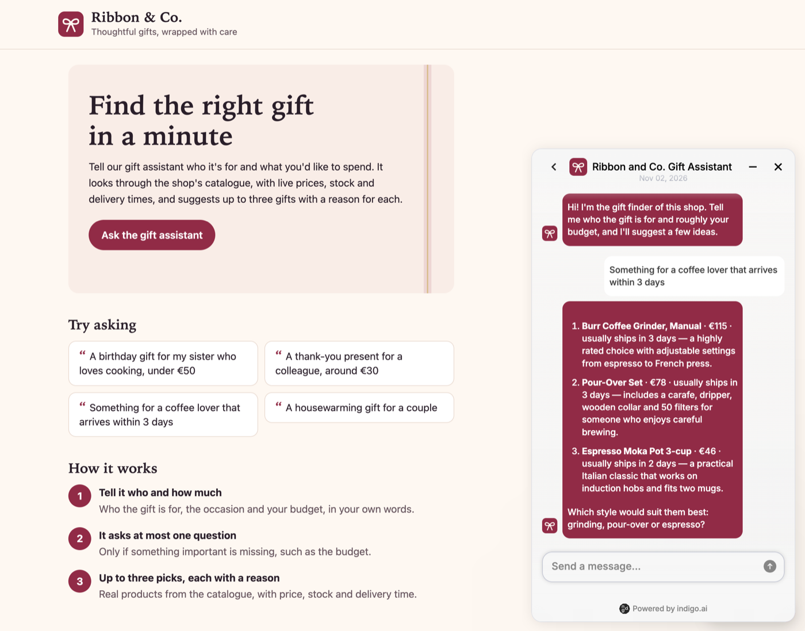
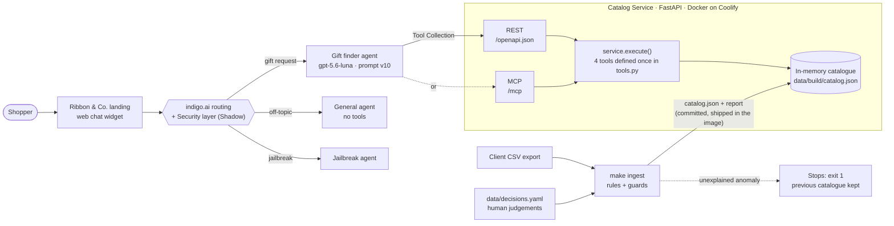
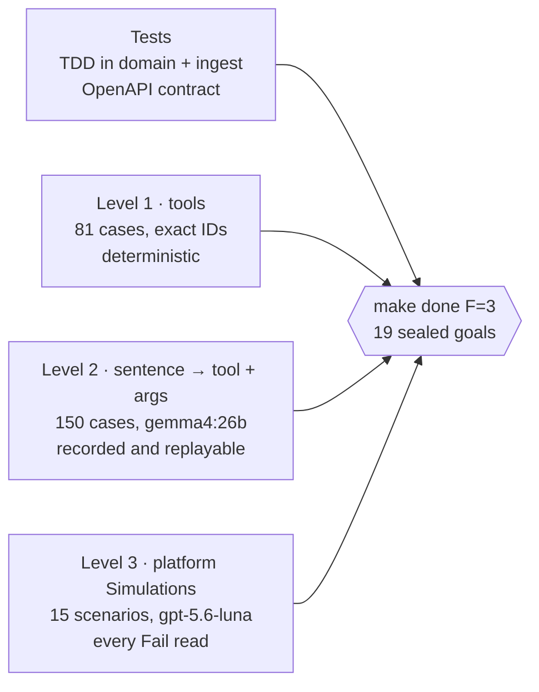

[🇮🇹 Italiano](README.md) · [🇪🇸 Español](README.es.md) · 🇬🇧 English

# Gift Shop Catalog


A catalogue service and a gift-finding agent for a small online gift shop, built for the
indigo.ai AI Forward Deployed Engineer assignment. The **Catalog Service** (Python, FastAPI)
cleans the client's CSV export with a repeatable, guarded ingest and exposes four read-only
tools, over REST with an OpenAPI document written for a language model, and over MCP. The
**Gift finder agent**, on the indigo.ai platform, turns a vague or precise request into at most
three products, each with a reason, in the shopper's language. It runs in the web chat of the
landing page of an invented shop, *Ribbon & Co.*



## Links

| What | Where |
|---|---|
| Landing page with the chat | https://catalog.178.18.243.118.sslip.io/ |
| Agent test page | https://clair.platform.indigo.ai/chatbot/4d2ebdf6-1913-4efe-b742-c457ebaeed6c |
| OpenAPI document (no key needed) | https://catalog.178.18.243.118.sslip.io/openapi.json |
| MCP endpoint (Streamable HTTP) | https://catalog.178.18.243.118.sslip.io/mcp |
| Health | https://catalog.178.18.243.118.sslip.io/health |
| Part 1 · How I work with AI | [PDF, one page](docs/ai-workflow/AI_WORKFLOW-en.pdf) · [Markdown](AI_WORKFLOW.md) |
| Video | https://drive.google.com/file/d/1m3NdjqQwMkuvs_3z5iWJyU38j2ObOtzl/view?usp=sharing |

Every data endpoint and `/mcp` need the header `X-API-Key` (`/mcp` also accepts
`Authorization: Bearer <key>`). Without it they answer 401 with a body that says how to send it.
The landing page, `/openapi.json` and `/health` are public.

The hostname uses sslip.io, which embeds the server's IP address in the name. Decided: no domain
was bought for a demo, because sslip.io gives a valid Let's Encrypt certificate at no cost and a
server IP is not a secret. A client deployment would sit behind the client's own domain.

## Five-minute tour

1. **Talk to the agent** on the [landing](https://catalog.178.18.243.118.sslip.io/): a vague request ("a gift for my mum"), a precise
   one ("something for a coffee lover, about 50 euros", then "show me more"), and something off-topic.
2. **Read what the model reads**: [`/openapi.json`](https://catalog.178.18.243.118.sslip.io/openapi.json), no key needed. Why the
   descriptions and responses look like that: [Tool design for an LLM](#tool-design-for-an-llm).
3. **Check the numbers**: [Measured](#measured), each figure with its `n`, command and artefact.
4. **See what the client's data needed**: [Data: cleaning and re-export safety](#data-cleaning-and-re-export-safety).
5. **Weigh the trade-offs**: [What was left out](#what-was-left-out-and-what-i-would-do-next) and [Time spent](#time-spent).

## Technologies

| Area | Choice |
|---|---|
| Language and runtime | Python 3.13 (pinned in `.python-version`), [uv](https://docs.astral.sh/uv/) for dependencies, exact pins (`==`) |
| Service | FastAPI and Pydantic, served by Uvicorn |
| MCP | MCP Python SDK 2.3.0, Streamable HTTP transport, stateless |
| Quality | pytest + hypothesis (property tests), ruff, mypy strict, tiktoken (`o200k_base`) to measure responses in tokens, detect-secrets |
| Deployment | Docker (non-root image with its own health check), Coolify on a Contabo VPS, Traefik with Let's Encrypt via sslip.io; a push to `main` redeploys |
| Agent | indigo.ai platform: Gift finder on **gpt-5.6-luna**, General and Jailbreak agents, Security layer, web chat widget |
| Level-2 evals | Ollama with **gemma4:26b**, locally, temperature 0, every response recorded |

## How it works



- **One tool definition, two transports.** `tools.py` holds each tool's name, descriptions and
  parameters once. The OpenAPI document and the MCP tool list are both generated from it, and
  every REST route and every MCP `tools/call` goes through `service.execute`. Decided: generate
  both from one source, because two hand-written copies of a tool description drift, and the
  model's behaviour depends on every word of it. `make eval-mcp` checks that MCP returns the same
  result as REST on every level-1 case (ADR-002, ADR-008).
- **The ingest is the only code that reads the CSV** (ADR-001, ADR-009). Anything it cannot
  explain stops it, and the previous catalogue stays in service.
- **In-memory snapshot** (ADR-004). The service loads `catalog.json` (152 listings, 150 products)
  at startup and answers from memory; search p95 is 0.20 ms in process. Search is a linear scan:
  a ×100 synthetic catalogue measured 35–39 ms p95 and 64 MB. Decided: no database, because at
  this size it adds a component and no measurable gain. The real weakness is stock freshness:
  stock is as fresh as the last export. Every response carries `meta.catalog_version`, so any
  answer traces back to the export behind it.

## Tool design for an LLM

The platform turns each OpenAPI operation into a tool, and the model decides what to call **from
the names and descriptions alone**. So the descriptions are the interface, and the responses are
written to be read by a model that must not invent anything (ADR-002).

### Four tools, one job each

| Tool | Route | Job |
|---|---|---|
| `get_categories` | `GET /categories` | What the shop sells: categories, subcategories, counts, price ranges, allowed filter values |
| `get_products_by_category` | `GET /categories/{category}/products` | Browse one category the shopper named |
| `search_products` | `GET /products/search` | Find products across the catalogue from a description |
| `get_product_details` | `GET /products/{product_id}` | Everything about one product, including caveats and in-stock alternatives |

The brief requires the first, second and fourth. Decided: add `search_products`, because a
100-conversation stress test (671 shopper messages in English, Spanish and Italian) showed that
most requests name a kind of product, a hobby or a brand, not a category. Search takes no
`category` parameter on purpose, so the model never chooses between two tools that do the same
thing.

Shared filters: price range, `recipient` (one or several, `her,couple`), `occasion`,
`max_shipping_days`, `exclude` (words matched in name, subcategory, tags and material, never the
description), `include_out_of_stock`, `sort`, `limit` (1–10, default 5) and `offset`.

<details>
<summary>Tools considered and rejected</summary>

With reasons in ADR-002: similar products, batch details, shop policies (there is no policy data,
and a tool would invite the model to fill the gap), `recommend_gift` (that is the agent's job,
and it would hide the reasoning), and a "guard" tool against injection (it only runs if the
manipulated model chooses to call it).

</details>

### What a response tells the model

A list item carries everything a recommendation needs without a second call: price,
availability, rating and review count, recipient, occasions, shipping days, gift wrap and the
shop's own description, where the caveats live ("needs an amplifier"). Optional blocks appear
only when they carry information:

| Block | Answers |
|---|---|
| `missing_terms` | Per product, the query words its record does not mention. The plain notebook for "leather notebook" says `["leather"]` |
| `over_budget_matches` | "A chef's knife under €100": the only one costs €149. Better matches above the budget, with `over_by_eur` |
| `out_of_stock_matches` | "Do you have the City Map jigsaw?" It exists but is out of stock, so the agent never says the shop does not sell it |
| `in_stock_alternatives` (details) | What to offer instead of an out-of-stock product: same subcategory first, closest in price |
| `unmatched_terms` | "Sony headphones": the shop does not carry Sony, so the agent says so, then offers the closest |
| `suggestions` | When results are few: the filter change that adds results, e.g. `max_price` → 149 adds 3. Only a change that keeps the request's meaning: never removing an exclusion or the recipient (ADR-011) |
| `meta` | `total_matches`, `returned`, `next_offset` for "show me more", the filters applied, today's date, catalogue version |

An empty result is a 200 with `total_matches: 0` and suggestions, not an error. **Token budget:**
every level-1 response is measured in tokens (`o200k_base`); the largest is 621 with the default
page and 1,045 with 10 items, against sealed limits of 1,150 and 1,800.

### Tolerant inputs, recoverable errors

The server resolves what it can and says so in a `note`: a category by slug, by name in any
spelling or by one word ("kitchen"); a product ID as `kd-7`, `KD7` or `kd-007`; closed-set values
in any case (`HER`, `Birthday`); a `limit` above 10 is clamped. Decided: tolerate these, because a
model that capitalises a value should not pay a round trip for it. What cannot be resolved is a
4xx with a single shape, which tells the model how to fix the call:

```json
{"error": {"code": "unknown_category",
           "message": "'garden' is not a category; Garden is a subcategory of Home & Living.",
           "hint": "Call get_products_by_category with category 'home-living' and subcategory 'Garden'.",
           "allowed_values": ["beauty-wellness", "..."], "did_you_mean": ["home-living"]}}
```

Strict where strictness informs: `nan`, `inf` and `min_price > max_price` are 400s with a hint. An
inverted range used to return an empty 200, which a model reads as "the shop has nothing".

<details>
<summary>Search: deterministic, no model in the loop</summary>

Keyword scoring, called that (ADR-003, ADR-005, ADR-006, ADR-007, ADR-010, ADR-011). Strong
fields say what a product is (name, subcategory, tags, occasions, brand); weak fields describe it
(material, colour, description). Results are ordered by coverage of the query in strong fields,
then any coverage, then word rarity, then rating.

- In a multi-word query the last specific word names the product ("leather *notebook*"), so a
  leather watch strap is not listed. If no product has that word in a strong field, the search
  narrows to products that have it in any of their own fields ("travel pillow").
- A small, reviewed vocabulary in `decisions.yaml` maps shopper words to catalogue words ("noise
  cancelling" → `anc`, "kindle" → e-reader, `cooking` ↔ `kitchen`). Pet products have their own
  recipient, so a dog toy does not answer "toy for kids".
- Ranking was frozen after three human reviews of the level-1 cases. What words cannot settle
  (open-ear buds are not noise cancelling) is left to the agent, which sees `missing_terms` for
  exactly that reason.

</details>

## The agent

### Platform setup

| Piece | Configuration |
|---|---|
| **Gift finder** | The only agent with tools. Prompt fields from [`agent/system-prompt.md`](agent/system-prompt.md) (v10). gpt-5.6-luna (EU), reasoning Low, creativity Low, short memory 20 messages, all tool calls kept in memory, 600 answer tokens |
| **General** | The platform's fallback agent, no tools: small talk, weather, returns, payments, tracking. Never invents a policy, never names products, steers back to the gift |
| **Jailbreak agent** | Receives jailbreak attempts routed by the Security layer |
| **Security layer** | On, in **Shadow** mode: it classifies and records every message, and blocks nothing yet |
| **Tools** | One Tool Collection from `/openapi.json`, header `X-API-Key: [[CATALOG_API_KEY]]` from a workspace secret. The MCP server was also connected and tested end to end in Preview; the agent runs on REST |

Decided: Shadow before Enforce, because Enforce on "out of scope" can block a mixed message that
also holds a real gift request, and the false positives should be read first. The platform's
Hallucination guardrail is not available in this workspace; the prompt rule "every product fact
comes from a tool call" covers that risk, and level 2 measures it.

### Conversation design

The prompt is written in the platform's fields: description, goal, tone, ten general rules and
five sections (asking questions, recommendation format, using the catalogue, reading the results,
outside the shop). The rules that shape a conversation:

- **At most one question per message, and at most two before showing products.** As soon as the
  person, a budget or a kind of product is known, search and show, then ask. A vague "I need a
  gift" gets one light question: who is it for, and roughly how much?
- **Up to three products per message**, best first, as a numbered list with one line per product:
  `1. **Name** · €price · usually ships in N days — one reason tied to what the shopper said`.
  "Only N left" when stock is low, then one short next step. Decided: a list, because the
  widget's rendering ran two-line blocks together however the blank lines were placed, and the
  numbers let the shopper say "the second one".
- **Every product fact comes from a tool call.** Search again whenever a condition changes, and
  search before saying the shop has or lacks something.
- **Reply in the language of the shopper's last message**; tool queries stay in English
  catalogue words.
- **Never guarantee delivery.** Shipping days are the shop's estimate: "usually ships in 3 days".
- **Read the blocks:** "out of stock", never "we don't sell it"; how far over budget a liked item
  is (the budget is the number the shopper said); say plainly when the shop does not carry a
  brand; "show me more" pages with `offset` and the same filters, and never raises the budget on
  its own.
- **Never confirm a property the record does not state.** To "is it definitely vegan?" the agent
  answers "the catalogue doesn't say whether it is vegan", then gives the materials.

### Off-topic and adversarial turns

Layered, with nothing that depends on the model choosing to protect itself:

1. **Before the model:** the Security layer classifies each message; jailbreak attempts go to the
   Jailbreak agent, out-of-scope requests to General.
2. **In the prompt:** weather or code gets one sentence and a question back to the gift. Returns,
   payments, discounts and tracking: "I have no information on that", a pointer to customer
   service, no guessing. Role changes and requests for the instructions are ignored. "Do you have
   AirPods?" is a shop question, so it is searched, not declined.
3. **In the service:** the tools only read public catalogue data, so a successful injection can
   only read what is already public. Product copy that reads like an instruction stops the ingest
   (`instruction_like_text`), matched on folded text so zero-width characters do not hide it.

Level 2 measures the second layer: none of the 36 off-topic cases calls a catalogue tool.

<details>
<summary>Model choice, by controlled comparison</summary>

gpt-4.1-mini padded answers and misread results ("nothing under 80" beside a 78-euro match), and
no prompt rule fixed it. Five models then ran the same nine scenarios with everything else fixed;
a public benchmark (τ²-Bench Airline) chose which to try, and the scenarios decided.
**gpt-5.6-luna** passed the core six after reading every Fail, flagged over-budget items with the
gap and kept the shopper's language, at half gpt-4.1-mini's price. Two models ranked higher by the
benchmark failed here (wrong language; raw tool-call tokens in the chat). Full table in
[`docs/PLATFORM.md`](docs/PLATFORM.md).

</details>

## Data: cleaning and re-export safety

The client's export (`data/gift-shop-catalog.csv`, 152 rows) is never edited. `make ingest` turns
it into the served catalogue (ADR-001, ADR-009):

- **General rules live in code, with tests:** trim, case, `and` → `&`, empty means missing (never
  zero).
- **One-off judgements live in [`data/decisions.yaml`](data/decisions.yaml)**, each with its
  reason: 11 categories, two cross-listed products, stock 999 = unlimited gift card, the search
  vocabulary.
- **Anything else stops the ingest** with a named code and keeps the previous catalogue: unknown
  category, duplicate ID, invalid value, instruction-like product copy, wrong schema, non-UTF-8 or
  empty file, ragged row, more than 20% of products removed, more than half repriced or restocked
  at once. A legitimate mass change (a sale) is accepted for one file only, keyed by its sha256.
- **Each export is a full snapshot**, diffed against the current catalogue, and the output is
  byte-identical for the same inputs. `data/build/` is committed, so a new export is a reviewed
  diff, a commit and a redeploy.

Seventeen seeded anomalies (a duplicated price column, UTF-16, a ragged row, a zero-width space
inside "Ignore previous instructions", a mass repricing…) each stop the ingest with exactly their
code: 17/17.

## Evaluation

Test ≠ eval. Tests pin code behaviour and must always pass (`make gate-fast`). Evals measure
quality against a threshold, each with its command and artefact in
[`docs/GOALS.yaml`](docs/GOALS.yaml), sealed by a sha256 lock. `make done F=3` reads every artefact
and compares it with its threshold.



<details>
<summary>What each level does</summary>

- **Tests.** TDD was mandatory in `domain` and `ingest`; the API layer is contract-tested,
  including a snapshot of the served OpenAPI and a check that route parameters match the spec.
- **Level 1, the tools (deterministic).** Arguments → exact product IDs, blocks and errors, run
  over HTTP. Expectations come from an independent reference implementation
  (`evals/golden/l1/oracle.py`, standard library only). The owner then reviewed the cases as a
  shop assistant would, in several rounds (`evals/golden/l1/review-v*.md`); his comments drove
  ADR-005 to ADR-007 and ADR-011, and held-out cases were registered before each round of rules.
- **Level 2, sentence → tool and arguments, with a real model.** 150 cases (36 off-topic), each a
  conversation so far plus the latest message. The model reads only the served spec and the
  prompt, through function calling. It runs on Gemma 4 26B locally (the platform offers
  gemma-4-26b), temperature 0, and every response is recorded, so the numbers re-score offline
  with no model and no key.
- **Level 3, conversations: the platform's Simulations.** 15 scenarios in
  [`evals/simulations/scenarios.csv`](evals/simulations/scenarios.csv): the brief's six (`core`),
  three more (`extra`) and six built from the tools' real output (`extended`). The judge sees the
  conversation, not the catalogue, so criteria judge behaviour and treat a fact as wrong only when
  it contradicts the reference. Every Fail is read against the catalogue before a result is
  recorded, and the table gives both verdicts.

</details>

### Measured

The latest run of each command. Reports are in [`evals/reports/`](evals/reports/).

| Metric | Value | Threshold | n | Command | Artefact |
|---|---|---|---|---|---|
| Unit and contract tests | 529 passed | all | 529 | `make test` | — |
| Line coverage, domain + ingest | 99.77% | ≥ 85% | 872 statements | `make test` | `coverage-latest.json` |
| Layer violations (domain ↛ api/mcp, api ↮ mcp) | 0 | 0 | — | `make test` | `arch-latest.json` |
| Data endpoints rejecting a missing, wrong or empty key | 12/12 | all | 12 | `make test` | `auth-latest.json` |
| Level 1: exact product IDs (public URL) | 81/81 | all | 81 | `make eval-l1` | `l1-latest.json` |
| Level 1: largest response, default / max page | 621 / 1,045 tokens | ≤ 1,150 / 1,800 | 81 | `make eval-l1` | `l1-latest.json` |
| Level 1: cases reviewed by the owner | 69 approved, 6 deferred, 6 pending (changed by ADR-011) | — | 81 | review sheet | `evals/golden/l1/REVIEW.md` |
| Level 2: right tool (gemma4:26b, prompt v10) | 85.3% | ≥ 90% (**not met**, see below) | 150 | `make eval-l2` | `l2-latest.json` |
| Level 2: right arguments, given the right tool | 96.2% | ≥ 85% | 150 | `make eval-l2` | `l2-latest.json` |
| Level 2: off-topic cases that call a tool | 0% | ≤ 5% | 36 | `make eval-l2` | `l2-latest.json` |
| Level 2: replay mismatches | 0 | 0 | 150 | `make eval-l2` | `l2-latest.json` |
| Simulations, core (gpt-5.6-luna, prompt v10) | 6/6 | 100% | 6 (1 run) | `make sim-report` | `simulations-latest.json` |
| Simulations, extended / extra (prompt v10) | 6/6 · 2/3 | — | 6 · 3 (1 run) | `make sim-report` | `simulations-latest.json` |
| Simulations, prompt v8: core / extra / extended, after reading | 18/18 · 9/9 · 16/18 | — | 3 runs | recorded per run | `evals/simulations/results.csv` |
| Ingest: client export, decisions pending | 0 | 0 | 152 rows | `make ingest` | `data/build/ingest-report.json` |
| Ingest: seeded anomalies stopped exactly | 17/17 | all | 17 | `make eval-ingest` | `ingest-latest.json` |
| MCP: same result as REST (in process and public URL) | 81/81 | all | 81 | `make eval-mcp` | `mcp-latest.json` |
| MCP: protocol checks over Streamable HTTP | 16/16 | all | 16 | `make eval-mcp` | `mcp-latest.json` |
| OpenAPI rule violations | 0 | 0 | — | `make spec-lint` | `spec-lint-latest.json` |
| New secrets outside the reviewed baseline | 0 | 0 | — | `make secrets` | `secrets-latest.json` |
| Deployed p95 latency, list and search | 193.4 ms over one reused connection (357.9–384.9 ms opening a new TLS connection per call) | ≤ 300 ms | 3 runs × 200 calls, 20 warm-up | `make latency URL=…` | `latency-latest.json` |
| Public checks from outside | 7/7 | all | 7 | `make check-public URL=…` | `public-latest.json` |
| Definition of done, phase 3 | 18/19 (only G-L2-TOOL fails) | 19/19 | 19 goals | `make done F=3` | — |

**G-L2-TOOL is not met, and the threshold was not lowered.** Tool choice on the local model, by
prompt version: v3 87.3%, v4 81.3%, v5 88.0%, v6 88.7%, v7 87.3%, v8 90.0%, v9 88.7%, v10 85.3%,
against ≥ 90%. None of these edits targeted tool choice, yet the number moved by up to 6.7 points
(v4 → v5 changed only the layout), so it reads as "about 85–90% on this local model". Most misses
are the model answering from earlier messages instead of calling a tool. Decided: keep 90%,
because lowering it after the fact would move the goalpost, and tuning the prompt further for a
model that is not in production would optimise the wrong thing. The production model passes the
core scenarios.

<details>
<summary>How the Simulations results are counted, and what they found</summary>

Each run is recorded in `evals/simulations/results.csv` with both verdicts (the judge's and the
one after reading). Runs of the same model and agent version count together, so re-running cannot
turn a result green. The real failures, and what each one led to:

- **v4**, "she likes cooking" found only the cookbook, and "tech gadgets" missed the speaker and
  the camera: a vocabulary gap, fixed in the data (ADR-010).
- **v7**, "budget around 40": a 42-euro candle called "within budget". v8: the budget is the
  number the shopper said, and anything above it is reported as over, with the amount.
- **v8**, "is it definitely vegan?" answered "Yes" from the materials, and a party game called
  "clearly child-friendly". v9 and v10: never confirm what the record does not state.
- **v10**, extra-9: a 52-euro product reported out of stock without saying it is also 2 euros over
  "about 50". Minor and real; prompt iteration stopped here, because each further line fixes one
  wording and risks another.

Latency is measured over one reused connection, as a server-to-server client such as the platform
calls; from the client machine a new TCP and TLS handshake per call adds about 115 ms.

</details>

## What the platform taught us

Found on screen, acted on, recorded in [`docs/PLATFORM.md`](docs/PLATFORM.md):

- **The platform reads an operation's `summary`, not its `description`.** The first import gave
  the model one-line summaries. The served spec now puts the full text in both, so a fresh import
  needs no hand edits.
- **An enum can stop the model from searching.** Asked for "the garden category", the model picked
  the nearest enum value (`outdoor-travel`). The browse tool now tells it to search when the
  shopper's word is not a category.
- **4xx bodies reach the model.** Asked for "lamps", the agent got the 404 and called again with
  `Lighting`, the subcategory the error names.
- **The MCP client sent the secret's placeholder, not its value.** A per-request log on `/mcp`
  (never the key) showed a 19-character key: the length of `[[CATALOG_API_KEY]]`. Worked around in
  the sandbox by typing the key into the MCP header; `/mcp` also accepts `Authorization: Bearer`.
- **The widget refuses an SVG icon URL** (a PNG is uploaded) and shows `&` escaped in the
  assistant name (`Ribbon &amp; Co.`), so it is called "Ribbon and Co.".
- **The widget's Markdown ran two-line product blocks together**, hence one numbered line per
  product.
- The served spec is OpenAPI 3.0.3 with every schema and enum inline (no `$ref`, no `oneOf`), so
  the platform's form editor can still edit each operation. `make spec-lint` enforces it.

## Running it locally

Requirements: [uv](https://docs.astral.sh/uv/) (Python 3.13 is pinned in `.python-version`).
Refreshing level 2 also needs Ollama with `gemma4:26b`; replaying the recordings does not.

```bash
uv sync
cp .env.example .env          # set CATALOG_API_KEY
make run                      # http://localhost:8000
curl -H "X-API-Key: $CATALOG_API_KEY" "localhost:8000/products/search?query=candle&max_price=40"
make gate-fast                # lint, types and the full test suite
```

**Docker:** `docker build -t gift-shop-catalog . && docker run -p 8000:8000 -e
CATALOG_API_KEY=change-me gift-shop-catalog`. The image ships the committed catalogue (no ingest
step), runs as a non-root user and declares its own health check.

<details>
<summary>Environment variables</summary>

| Variable | Required | Meaning |
|---|---|---|
| `CATALOG_API_KEY` | yes | The key callers send in `X-API-Key`. The service refuses to start without one |
| `WIDGET_TOKEN` | no | The platform's workspace token for the web chat on `/`. Without a valid one, the page renders without the chat |
| `SHOP_TIMEZONE` | no | The zone for `meta.today`. Default `Europe/Rome` |
| `CATALOG_URL` | no | Runs `make eval-l1` against a deployment instead of in process |
| `TEST_PAGE_URL` | no | The agent's test page, checked by `make check-public` |

</details>

<details>
<summary>Make targets</summary>

| Target | What it does |
|---|---|
| `make gate-fast` | Lint, types and the full test suite: what must stay green after each change |
| `make test` | pytest with the coverage, auth and layer reports (`make lint`, `make typecheck` run the rest) |
| `make ingest` | CSV + `decisions.yaml` → `data/build/catalog.json` and the report; exit 1 means a decision is needed |
| `make eval-ingest` | Seeded-anomaly fixtures must each stop the ingest with exactly their anomaly |
| `make eval-l1` | Level-1 cases over HTTP: exact match and response size in tokens |
| `make golden-l1` | Rebuild the level-1 cases from the reference implementation, plus the review sheet |
| `make eval-l2` | Level 2 replayed from the recorded model responses |
| `make eval-l2-refresh` | Level 2 calling the local model for cases without a recording |
| `make eval-mcp` | MCP against REST on the level-1 cases, plus protocol checks; `URL=` for a deployment |
| `make sim-report` | Simulation verdicts recorded per run → report |
| `make spec-lint` | Lint the served OpenAPI against the platform's rules |
| `make secrets` | Secrets in tracked files that are not in the reviewed baseline |
| `make latency URL=…` · `make check-public URL=…` | p95 latency and public checks against a deployment |
| `make done F=<n>` | Definition of done for a phase: every goal's artefact against its sealed threshold |
| `make audit-csv` | Independent audit of the raw export, standard library only |

</details>

<details>
<summary>Repository layout</summary>

| Path | What it holds |
|---|---|
| `src/catalog/tools.py` | The four tools, defined once: name, description for the model, parameters, response schema |
| `src/catalog/service.py` | `execute()`: one entry point per tool call, shared by REST and MCP; input normalisation; response bodies |
| `src/catalog/domain/` | The catalogue in memory: search, browse, details, ranking, near misses. No web framework imports |
| `src/catalog/ingest/` | CSV + decisions → served catalogue and report, with every stopping rule |
| `src/catalog/api/` | FastAPI app (`app.py`), generated OpenAPI (`openapi.py`), MCP server (`mcp.py`), landing page |
| `data/gift-shop-catalog.csv` | The client's export, as received. Never edited |
| `data/decisions.yaml` | Human judgements with a reason each: categories, cross-listings, sentinels, guards, search vocabulary |
| `data/build/` | `catalog.json` (what the service serves) and `ingest-report.json`. Committed, so a new export is a diff |
| `agent/system-prompt.md` | The agent's prompt, field by field as the platform takes it, with a version history |
| `evals/` | Level-1 cases, level-2 cases and recordings, simulation scenarios and results, ingest and MCP evals, reports |
| `docs/` | ADRs, goals and their lock, platform configuration, engineering journal, Part 1 PDFs |
| `scripts/` | Spec lint, secrets check, coverage summary, remote checks, definition of done, scale probe, raw CSV audit |

</details>

## Time spent

About **29 hours over five days**. The engineering journal records each block of work with an
approximate duration written at the time; looking back, those estimates ran about 20 % high, so
the figures below are scaled down by that much.

| Day | Main work | Time |
|---|---|---|
| Thu 29 Oct | Brief, platform guide, goals, hosting choice, data audit, pipeline design | ≈ 5 h 35 |
| Fri 30 Oct | Ingest and domain test-first, 100-conversation stress test, tool interface, REST and OpenAPI, three reviews of the level-1 cases | ≈ 5 h 50 |
| Sat 31 Oct | Deployment, level 2 on a local model, prompt v2–v3, platform configuration, first Simulations | ≈ 5 h |
| Sun 1 – Mon 2 Nov, into the night | Prompt v4–v10, model comparison, re-export safety, MCP, landing page, search vocabulary, latency, MCP on the platform, Simulations, review of bank v5, README, Part 1 | ≈ 9 h 55 |
| Mon 2 Nov | Review against the brief, README tour and screenshot, video | ≈ 2 h 40 |

By area, roughly: the agent (prompt, level 2, platform, model choice, Simulations) ≈ 9.5 h; tool
interface and search, including the reviews ≈ 6.5 h; understanding the brief and the platform,
goals, working rules ≈ 3.5 h; data ≈ 3 h; hosting and latency ≈ 1.5 h; MCP and landing page ≈ 1.5 h;
README, Part 1 and the video ≈ 3.5 h.

## What was left out, and what I would do next

Left out on purpose, each with its reason in the ADR named:

- **A `/catalog/report` page** showing anomalies, decisions and the catalogue version. Cut for
  time; the same information is in `data/build/ingest-report.json`. A data-upload portal was
  rejected outright: a write path and a second auth scheme on a public sandbox (ADR-001).
- **LLM enrichment of product data** (ADR-003). To revisit when the catalogue reaches thousands of
  products, or level 1 shows misses from vocabulary no column holds, with a grounding check by
  code and human review of changed rows.
- **A real search engine** (ADR-004): SQLite FTS5 at tens of thousands of products, then a search
  service with incremental ingest, live stock and cursor pagination.
- **Ingest gaps** (ADR-009): the removal guard has no per-export acceptance, only its ratio;
  header names are not normalised (`PRICE_EUR` stops, on purpose); look-alike letters from other
  scripts (Cyrillic `а`) can still hide an injection phrase.
- **Mutation testing.** Dropped from the goals: a new dependency, and it blocks nothing.

Next, in order:

1. **Enforce mode for the Security layer**, after reading the Shadow logs for false positives on
   mixed messages.
2. **More Simulations runs on prompt v10.** One run per suite can be luck; a pass rate needs
   several runs per scenario.
3. **Report the MCP secret placeholder to the platform**, and go back to a workspace secret
   instead of the key typed into the header.
4. **Ranking comments deferred by the freeze** (ADR-006): a sauna blanket as a throw, incense for
   children (a client data issue), a pepper mill for "coffee grinder", chess as a wooden board
   game. They become rules only if the agent recommends the wrong product because of the order.
5. **`over_budget_matches` ordering:** for "coffee" it lists the €115 grinder above the €78
   pour-over set, because a name match beats a tag match. The nearer price is the better offer.
6. **Reviews still open:** the 6 level-1 cases changed by ADR-011 (l1-066, 070, 071, 076, 077,
   078) await a second human review, and so do the level-2 cases the model passed (only level-2
   failures were reviewed by a person). This does not change the product's quality: the cases
   pass, and the behaviour they cover is checked end to end by the Simulations. The review
   confirms the expectations, not the service.

## Further reading

- [`docs/adr/`](docs/adr/): data cleaning (001), tool interface (002), no LLM enrichment (003),
  in-memory catalogue (004), search relevance (005–007), MCP server (008), re-export safety (009),
  search vocabulary and pets (010), suggestions and the main word (011).
- [Engineering journal](docs/JOURNAL.md): the reasoning behind each decision, including what
  failed, with the numbers and their commands.
- [Platform configuration](docs/PLATFORM.md), [goals](docs/GOALS.yaml),
  [agent prompt](agent/system-prompt.md), [Part 1 · How I work with AI](AI_WORKFLOW.md).
