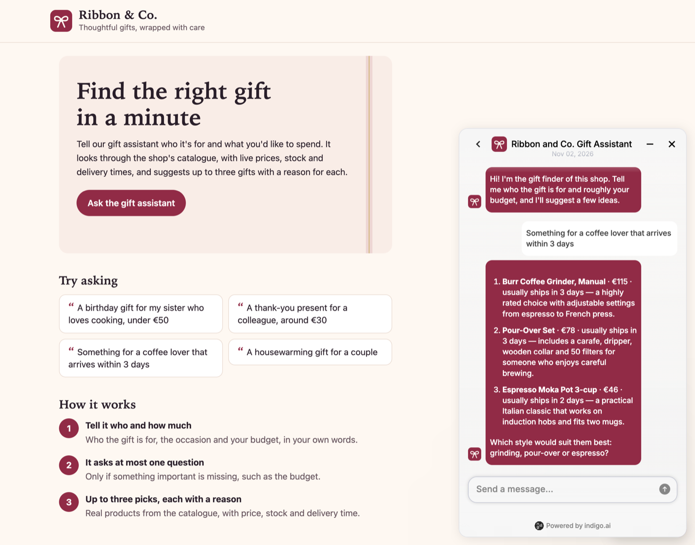
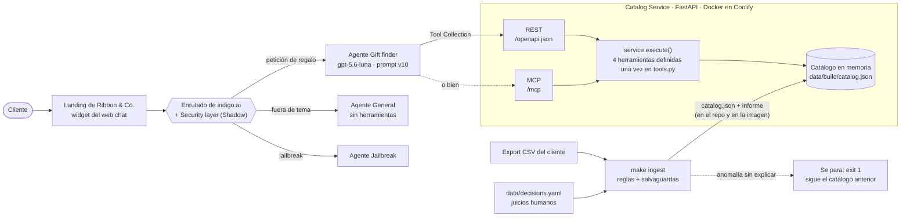
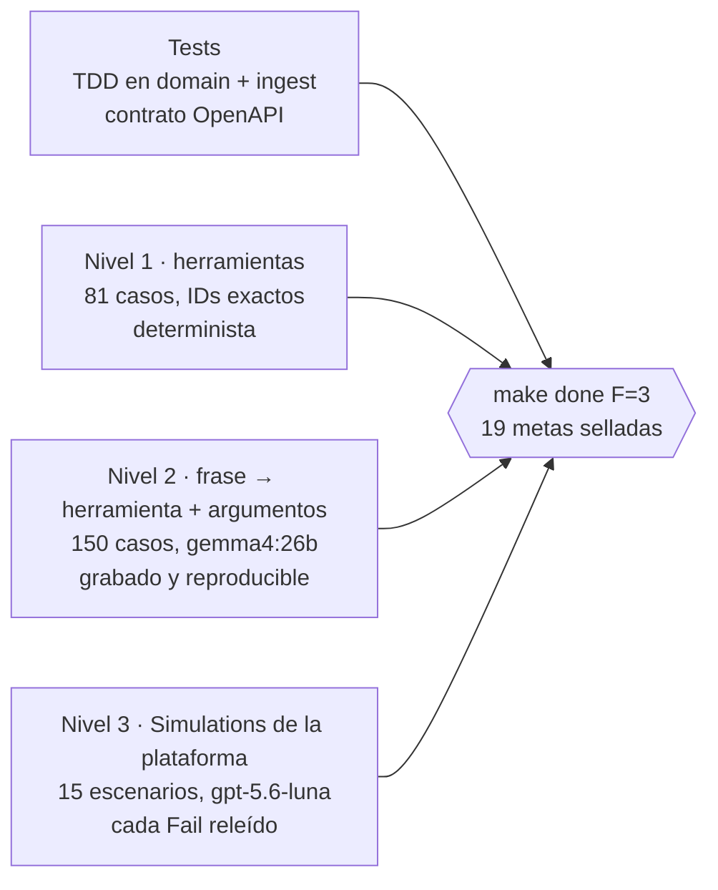

[🇮🇹 Italiano](README.md) · 🇪🇸 Español · [🇬🇧 English](README.en.md)

# Gift Shop Catalog


Un servicio de catálogo y un agente que ayuda a encontrar regalos, para una pequeña tienda
online. Es la prueba técnica de indigo.ai para el puesto de AI Forward Deployed Engineer. El
**Catalog Service** (Python, FastAPI) limpia el export CSV del cliente con un ingest repetible y
vigilado, y expone cuatro herramientas de solo lectura: por REST, con un documento OpenAPI
escrito para un modelo de lenguaje, y por MCP. El **agente Gift finder**, en la plataforma
indigo.ai, convierte una petición vaga o concreta en un máximo de tres productos, cada uno con un
motivo, en el idioma del cliente. Vive en el chat de la landing de una tienda inventada,
*Ribbon & Co.*



## Enlaces

| Qué | Dónde |
|---|---|
| Landing con el chat | https://catalog.178.18.243.118.sslip.io/ |
| Página de prueba del agente | https://clair.platform.indigo.ai/chatbot/4d2ebdf6-1913-4efe-b742-c457ebaeed6c |
| Documento OpenAPI (sin clave) | https://catalog.178.18.243.118.sslip.io/openapi.json |
| Endpoint MCP (Streamable HTTP) | https://catalog.178.18.243.118.sslip.io/mcp |
| Health | https://catalog.178.18.243.118.sslip.io/health |
| Parte 1 · Cómo trabajo con IA | [PDF, una página](docs/ai-workflow/AI_WORKFLOW-es.pdf) · [Markdown (inglés)](AI_WORKFLOW.md) |
| Vídeo | `<VIDEO_URL>` |

Todos los endpoints de datos y `/mcp` exigen la cabecera `X-API-Key` (`/mcp` acepta también
`Authorization: Bearer <key>`). Sin ella responden 401, con un cuerpo que explica cómo enviarla.
La landing, `/openapi.json` y `/health` son públicos.

El dominio usa sslip.io, que incluye la IP del servidor en el nombre. Decidido: no comprar un
dominio para una demo, porque sslip.io da gratis un certificado válido de Let's Encrypt y la IP de
un servidor no es un secreto. En producción, el servicio iría detrás del dominio del cliente.

## El recorrido en cinco minutos

1. **Habla con el agente** en la [landing](https://catalog.178.18.243.118.sslip.io/): una petición vaga ("un regalo para mi madre"),
   una precisa ("algo para alguien a quien le encanta el café, unos 50 euros", y luego "enséñame más") y una fuera de tema.
2. **Lee lo que lee el modelo**: [`/openapi.json`](https://catalog.178.18.243.118.sslip.io/openapi.json), sin clave. Por qué las
   descripciones y las respuestas son así: [Herramientas pensadas para un LLM](#herramientas-pensadas-para-un-llm).
3. **Comprueba los números**: [Medido](#medido), cada cifra con su `n`, su comando y su artefacto.
4. **Mira qué necesitaban los datos del cliente**: [Datos: limpieza y seguridad ante nuevos exports](#datos-limpieza-y-seguridad-ante-nuevos-exports).
5. **Sopesa los compromisos**: [Qué se quedó fuera](#qué-se-quedó-fuera-y-qué-haría-después) y [Tiempo dedicado](#tiempo-dedicado).

## Tecnologías

| Ámbito | Elección |
|---|---|
| Lenguaje y entorno | Python 3.13 (fijado en `.python-version`), [uv](https://docs.astral.sh/uv/) para las dependencias, versiones exactas (`==`) |
| Servicio | FastAPI y Pydantic, servido con Uvicorn |
| MCP | MCP Python SDK 2.3.0, transporte Streamable HTTP, sin estado |
| Calidad | pytest + hypothesis (tests de propiedades), ruff, mypy strict, tiktoken (`o200k_base`) para medir las respuestas en tokens, detect-secrets |
| Despliegue | Docker (imagen sin root con su propio health check), Coolify en un VPS de Contabo, Traefik con Let's Encrypt vía sslip.io; un push a `main` vuelve a desplegar |
| Agente | Plataforma indigo.ai: Gift finder con **gpt-5.6-luna**, agentes General y Jailbreak, Security layer, widget del web chat |
| Evals de nivel 2 | Ollama con **gemma4:26b**, en local, temperatura 0, cada respuesta grabada |

## Cómo funciona



- **Una sola definición de las herramientas, dos transportes.** `tools.py` guarda una sola vez el
  nombre, las descripciones y los parámetros de cada herramienta. El documento OpenAPI y la lista
  de herramientas MCP se generan a partir de él, y toda ruta REST y todo `tools/call` de MCP pasa
  por `service.execute`. Decidido: generar ambos desde una sola fuente, porque dos copias escritas
  a mano acaban divergiendo, y el comportamiento del modelo depende de cada palabra de la
  descripción. `make eval-mcp` comprueba que MCP devuelve el mismo resultado que REST en cada caso
  de nivel 1 (ADR-002, ADR-008).
- **El ingest es el único código que lee el CSV** (ADR-001, ADR-009). Lo que no sabe explicar lo
  detiene, y sigue en servicio el catálogo anterior.
- **Instantánea en memoria** (ADR-004). Al arrancar, el servicio carga `catalog.json` (152
  fichas, 150 productos) y responde desde memoria; el p95 de búsqueda es de 0,20 ms en proceso. La
  búsqueda es un recorrido lineal: un catálogo sintético ×100 dio 35–39 ms de p95 y 64 MB.
  Decidido: sin base de datos, porque a este tamaño añade una pieza sin ganancia medible. El punto
  débil real es la frescura del stock: está tan al día como el último export. Cada respuesta lleva
  `meta.catalog_version`, así que cualquier respuesta se puede rastrear hasta su export.

## Herramientas pensadas para un LLM

La plataforma convierte cada operación OpenAPI en una herramienta, y el modelo decide qué llamar
**solo a partir de los nombres y las descripciones**. Así que las descripciones son la interfaz.
Las respuestas están escritas para que las lea un modelo que no debe inventarse nada (ADR-002).

### Cuatro herramientas, una tarea cada una

| Herramienta | Ruta | Tarea |
|---|---|---|
| `get_categories` | `GET /categories` | Qué vende la tienda: categorías, subcategorías, recuentos, rangos de precio, valores admitidos en los filtros |
| `get_products_by_category` | `GET /categories/{category}/products` | Recorrer una categoría que nombra el cliente |
| `search_products` | `GET /products/search` | Encontrar productos en todo el catálogo a partir de una descripción |
| `get_product_details` | `GET /products/{product_id}` | Todo sobre un producto, con sus advertencias y alternativas en stock |

El enunciado pide la primera, la segunda y la cuarta. Decidido: añadir `search_products`, porque
una prueba de estrés de 100 conversaciones (671 mensajes en inglés, español e italiano) mostró
que casi todas las peticiones nombran un tipo de producto, una afición o una marca, no una
categoría. La búsqueda no tiene parámetro `category` a propósito: así el modelo nunca elige entre
dos herramientas que hacen lo mismo.

Filtros comunes: rango de precio, `recipient` (uno o varios, `her,couple`), `occasion`,
`max_shipping_days`, `exclude` (palabras que se buscan en nombre, subcategoría, etiquetas y
material, nunca en la descripción), `include_out_of_stock`, `sort`, `limit` (1–10, 5 por
defecto) y `offset`.

<details>
<summary>Herramientas consideradas y descartadas</summary>

Con sus razones en el ADR-002: productos similares, detalles en lote, políticas de la tienda (no
hay datos de políticas, y una herramienta invitaría al modelo a rellenar el hueco),
`recommend_gift` (es el trabajo del agente, y escondería el razonamiento) y una herramienta de
"guardia" contra inyecciones (solo se ejecutaría si el modelo manipulado decidiera llamarla).

</details>

### Qué le dice una respuesta al modelo

Cada elemento de la lista lleva todo lo necesario para recomendarlo sin una segunda llamada:
precio, disponibilidad, valoración y número de reseñas, destinatario, ocasiones, días de envío,
envoltorio de regalo y la descripción de la propia tienda, donde están las advertencias ("necesita
un amplificador"). Los bloques opcionales solo aparecen cuando aportan información:

| Bloque | Responde a |
|---|---|
| `missing_terms` | Por producto, las palabras de la búsqueda que su ficha no menciona. La libreta sencilla para "leather notebook" dice `["leather"]` |
| `over_budget_matches` | "Un cuchillo de chef por menos de 100 €": el único cuesta 149 €. Mejores resultados por encima del presupuesto, con `over_by_eur` |
| `out_of_stock_matches` | "¿Tenéis el puzle City Map?" Existe pero está agotado, así que el agente nunca dice que la tienda no lo vende |
| `in_stock_alternatives` (detalles) | Qué ofrecer en lugar de un producto agotado: primero la misma subcategoría, luego el precio más cercano |
| `unmatched_terms` | "Auriculares Sony": la tienda no trabaja Sony, el agente lo dice y ofrece lo más parecido |
| `suggestions` | Con pocos resultados: el cambio de filtro que añade resultados, p. ej. `max_price` → 149 añade 3. Solo cambios que mantienen el sentido de la petición: nunca quitar una exclusión ni el destinatario (ADR-011) |
| `meta` | `total_matches`, `returned`, `next_offset` para "enséñame más", filtros aplicados, fecha de hoy, versión del catálogo |

Un resultado vacío es un 200 con `total_matches: 0` y sugerencias, no un error. **Presupuesto de
tokens:** cada respuesta de nivel 1 se mide en tokens (`o200k_base`). La mayor tiene 621 con la
página por defecto y 1.045 con 10 elementos, frente a límites sellados de 1.150 y 1.800.

### Entradas tolerantes, errores recuperables

El servidor resuelve lo que puede y lo indica en una `note`: una categoría por slug, por nombre
escrito de cualquier forma o por una palabra ("kitchen"); un ID de producto como `kd-7`, `KD7` o
`kd-007`; valores de conjuntos cerrados en mayúsculas o minúsculas (`HER`, `Birthday`); un `limit`
mayor que 10 se recorta. Decidido: tolerarlos, porque un modelo que escribe un valor en
mayúsculas no tiene por qué pagarlo con otra llamada. Lo que no se puede resolver es un 4xx con
una única forma, que le dice al modelo cómo corregir la llamada:

```json
{"error": {"code": "unknown_category",
           "message": "'garden' is not a category; Garden is a subcategory of Home & Living.",
           "hint": "Call get_products_by_category with category 'home-living' and subcategory 'Garden'.",
           "allowed_values": ["beauty-wellness", "..."], "did_you_mean": ["home-living"]}}
```

Estricto donde la rigidez informa: `nan`, `inf` y `min_price > max_price` son 400 con una pista.
Antes, un rango invertido devolvía un 200 vacío, que un modelo lee como "la tienda no tiene nada".

<details>
<summary>Búsqueda: determinista, sin modelo de por medio</summary>

Puntuación por palabras clave, y se llama así (ADR-003, ADR-005, ADR-006, ADR-007, ADR-010,
ADR-011). Los campos fuertes dicen qué es un producto (nombre, subcategoría, etiquetas, ocasiones,
marca); los débiles lo describen (material, color, descripción). Los resultados se ordenan por
cobertura de la búsqueda en campos fuertes, luego por cobertura en cualquier campo, luego por
rareza de las palabras y luego por valoración.

- En una búsqueda de varias palabras, la última palabra específica nombra el producto ("leather
  *notebook*"), así que una correa de reloj de piel no aparece. Si ningún producto tiene esa
  palabra en un campo fuerte, la búsqueda se limita a los que la tienen en cualquiera de sus
  campos ("travel pillow").
- Un vocabulario pequeño y revisado en `decisions.yaml` traduce las palabras del cliente a las
  del catálogo ("noise cancelling" → `anc`, "kindle" → e-reader, `cooking` ↔ `kitchen`). Los
  productos para mascotas tienen su propio destinatario, así que un juguete para perros no
  responde a "juguete para niños".
- El ranking se congeló tras tres revisiones humanas de los casos de nivel 1. Lo que las palabras
  no pueden decidir (unos auriculares open-ear no tienen cancelación de ruido) queda para el
  agente, que para eso ve `missing_terms`.

</details>

## El agente

### Configuración en la plataforma

| Pieza | Configuración |
|---|---|
| **Gift finder** | El único agente con herramientas. Campos del prompt de [`agent/system-prompt.md`](agent/system-prompt.md) (v10). gpt-5.6-luna (EU), razonamiento Low, creatividad Low, memoria corta de 20 mensajes, todas las llamadas a herramientas en memoria, 600 tokens de respuesta |
| **General** | El agente de reserva de la plataforma, sin herramientas: charla, tiempo, devoluciones, pagos, seguimiento. Nunca se inventa una política, no nombra productos y reconduce hacia el regalo |
| **Agente Jailbreak** | Recibe los intentos de jailbreak que le envía el Security layer |
| **Security layer** | Activo, en modo **Shadow**: clasifica y registra cada mensaje, y de momento no bloquea nada |
| **Herramientas** | Una Tool Collection desde `/openapi.json`, con la cabecera `X-API-Key: [[CATALOG_API_KEY]]` desde un secreto del workspace. El servidor MCP también se conectó y se probó de punta a punta en Preview; el agente funciona con REST |

Decidido: primero Shadow y luego Enforce, porque Enforce sobre "fuera de ámbito" puede bloquear un
mensaje mixto que además trae una petición de regalo real, y antes hay que leer los falsos
positivos. El guardrail de Hallucination de la plataforma no está disponible en este workspace;
cubre ese riesgo la regla del prompt "todo dato de producto sale de una llamada a una
herramienta", que mide el nivel 2.

### Diseño de la conversación

El prompt está escrito en los campos de la plataforma: descripción, objetivo, tono, diez reglas
generales y cinco secciones (hacer preguntas, formato de las recomendaciones, uso del catálogo,
lectura de resultados, fuera de la tienda). Las reglas que dan forma a la conversación:

- **Como mucho una pregunta por mensaje, y como mucho dos antes de enseñar productos.** En cuanto
  se sabe la persona, un presupuesto o un tipo de producto, el agente busca y enseña, y después
  pregunta. A un vago "necesito un regalo" responde con una sola pregunta ligera: ¿para quién es,
  y cuánto quieres gastar más o menos?
- **Hasta tres productos por mensaje**, el mejor primero, en una lista numerada con una línea por
  producto: `1. **Nombre** · €precio · suele enviarse en N días — un motivo ligado a lo que dijo el
  cliente`. "Solo quedan N" cuando hay poco stock, y después un siguiente paso breve. Decidido: una
  lista, porque el widget juntaba los bloques de dos líneas pusiera donde pusiera las líneas en
  blanco, y los números permiten al cliente decir "el segundo".
- **Todo dato de producto sale de una llamada a una herramienta.** Si cambia una condición, vuelve
  a buscar; antes de decir que la tienda tiene o no tiene algo, lo busca.
- **Responde en el idioma del último mensaje del cliente**; las búsquedas en las herramientas van
  en inglés, con las palabras del catálogo.
- **Nunca garantiza la entrega.** Los días de envío son una estimación de la tienda: "suele
  enviarse en 3 días".
- **Lee los bloques:** "agotado", nunca "no lo vendemos"; cuánto se pasa del presupuesto un
  producto que gusta (el presupuesto es la cifra que dijo el cliente); dice claramente cuando la
  tienda no trabaja una marca; "enséñame más" pagina con `offset` y los mismos filtros, y nunca
  sube el presupuesto por su cuenta.
- **Nunca confirma una propiedad que la ficha no recoge.** A "¿es seguro que es vegano?" responde
  "el catálogo no dice si es vegano", y luego da los materiales.

### Mensajes fuera de tema e intentos de manipulación

Por capas, y ninguna depende de que el modelo decida protegerse:

1. **Antes del modelo:** el Security layer clasifica cada mensaje; los intentos de jailbreak van
   al agente Jailbreak y las peticiones fuera de ámbito, a General.
2. **En el prompt:** al tiempo o al código responde con una frase y una pregunta que vuelve al
   regalo. Devoluciones, pagos, descuentos y seguimiento: "no tengo información sobre eso", una
   indicación hacia atención al cliente, sin suposiciones. Ignora los cambios de rol y las
   peticiones de revelar las instrucciones. "¿Tenéis AirPods?" es una pregunta sobre la tienda: se
   busca, no se rechaza.
3. **En el servicio:** las herramientas solo leen datos públicos del catálogo, así que una
   inyección que funcione solo puede leer lo que ya es público. Un texto de producto que parece
   una instrucción detiene el ingest (`instruction_like_text`); se compara sobre texto
   normalizado, así que los caracteres de ancho cero no lo esconden.

El nivel 2 mide la segunda capa: ninguno de los 36 casos fuera de tema llama a una herramienta
del catálogo.

<details>
<summary>Elección del modelo, con una comparación controlada</summary>

gpt-4.1-mini alargaba las respuestas y leía mal los resultados ("nada por debajo de 80" junto a
un producto de 78 €), y ninguna regla del prompt lo corrigió. Después, cinco modelos ejecutaron
los mismos nueve escenarios con todo lo demás fijo: un benchmark público (τ²-Bench Airline) eligió
cuáles probar, y los escenarios decidieron. **gpt-5.6-luna** pasó los seis escenarios core tras
leer cada Fail, señaló los productos fuera de presupuesto con la diferencia y mantuvo el idioma
del cliente, a mitad de precio que gpt-4.1-mini. Dos modelos mejor clasificados en el benchmark
fallaron aquí (idioma equivocado; tokens en bruto de llamadas a herramientas en el chat). Tabla
completa en [`docs/PLATFORM.md`](docs/PLATFORM.md).

</details>

## Datos: limpieza y seguridad ante nuevos exports

El export del cliente (`data/gift-shop-catalog.csv`, 152 filas) nunca se edita. `make ingest` lo
convierte en el catálogo servido (ADR-001, ADR-009):

- **Las reglas generales viven en el código, con tests:** espacios, mayúsculas, `and` → `&`,
  vacío significa que falta (nunca cero).
- **Los juicios puntuales viven en [`data/decisions.yaml`](data/decisions.yaml)**, cada uno con
  su motivo: 11 categorías, dos productos en dos categorías, stock 999 = tarjeta regalo ilimitada,
  el vocabulario de búsqueda.
- **Todo lo demás detiene el ingest** con un código concreto y mantiene el catálogo anterior:
  categoría desconocida, ID duplicado, valor no válido, texto de producto que parece una
  instrucción, esquema incorrecto, fichero que no es UTF-8 o vacío, fila con columnas de más o de
  menos, más del 20% de productos retirados, más de la mitad con precio o stock cambiados de
  golpe. Un cambio masivo legítimo (rebajas) se acepta para un único fichero, identificado por su
  sha256.
- **Cada export es una foto completa**, comparada con el catálogo actual, y con las mismas
  entradas la salida es idéntica byte a byte. `data/build/` está en el repo, así que un export
  nuevo es un diff revisado, un commit y un nuevo despliegue.

Diecisiete anomalías sembradas (una columna de precio duplicada, UTF-16, una fila descuadrada, un
espacio de ancho cero dentro de "Ignore previous instructions", un cambio de precios masivo…)
detienen cada una el ingest con su código exacto: 17/17.

## Evaluación

Test ≠ eval. Los tests fijan el comportamiento del código y tienen que pasar siempre (`make
gate-fast`). Las evals miden la calidad frente a un umbral, cada una con su comando y su
artefacto en [`docs/GOALS.yaml`](docs/GOALS.yaml), sellado con un lock sha256. `make done F=3`
lee cada artefacto y lo compara con su umbral.



<details>
<summary>Qué hace cada nivel</summary>

- **Tests.** TDD obligatorio en `domain` e `ingest`; la capa API se prueba por contrato, con una
  instantánea de la OpenAPI servida y una comprobación de que los parámetros de las rutas
  coinciden con la especificación.
- **Nivel 1, las herramientas (determinista).** Argumentos → IDs de producto exactos, bloques y
  errores, ejecutados por HTTP. Los resultados esperados salen de una implementación de referencia
  independiente (`evals/golden/l1/oracle.py`, solo biblioteca estándar). Después, el propietario
  revisó los casos como lo haría un dependiente, en varias rondas
  (`evals/golden/l1/review-v*.md`); sus comentarios dieron lugar a los ADR del 005 al 007 y al
  ADR-011, y antes de cada ronda de reglas se registraron casos reservados que no se usaron para
  desarrollar.
- **Nivel 2, frase → herramienta y argumentos, con un modelo real.** 150 casos (36 fuera de
  tema), cada uno con la conversación hasta ese momento y el último mensaje. El modelo solo lee la
  especificación servida y el prompt, mediante function calling. Funciona en local con Gemma 4 26B
  (la plataforma ofrece gemma-4-26b), a temperatura 0, y cada respuesta se graba: los números se
  recalculan sin conexión, sin modelo y sin clave.
- **Nivel 3, conversaciones: las Simulations de la plataforma.** 15 escenarios en
  [`evals/simulations/scenarios.csv`](evals/simulations/scenarios.csv): los seis del enunciado
  (`core`), tres más (`extra`) y seis construidos con la salida real de las herramientas
  (`extended`). El juez ve la conversación pero no el catálogo, así que los criterios juzgan el
  comportamiento y solo dan un dato por erróneo si contradice la referencia. Cada Fail se relee
  contra el catálogo antes de registrar el resultado, y la tabla da los dos veredictos.

</details>

### Medido

La última ejecución de cada comando. Los informes están en [`evals/reports/`](evals/reports/).

| Métrica | Valor | Umbral | n | Comando | Artefacto |
|---|---|---|---|---|---|
| Tests unitarios y de contrato | 529 superados | todos | 529 | `make test` | — |
| Cobertura de líneas, domain + ingest | 99,77% | ≥ 85% | 872 sentencias | `make test` | `coverage-latest.json` |
| Violaciones de capas (domain ↛ api/mcp, api ↮ mcp) | 0 | 0 | — | `make test` | `arch-latest.json` |
| Endpoints de datos que rechazan una clave ausente, errónea o vacía | 12/12 | todos | 12 | `make test` | `auth-latest.json` |
| Nivel 1: IDs de producto exactos (URL pública) | 81/81 | todos | 81 | `make eval-l1` | `l1-latest.json` |
| Nivel 1: respuesta más grande, página por defecto / máxima | 621 / 1.045 tokens | ≤ 1.150 / 1.800 | 81 | `make eval-l1` | `l1-latest.json` |
| Nivel 1: casos revisados por el propietario | 69 aprobados, 6 aplazados, 6 pendientes (cambiados por el ADR-011) | — | 81 | hoja de revisión | `evals/golden/l1/REVIEW.md` |
| Nivel 2: herramienta correcta (gemma4:26b, prompt v10) | 85,3% | ≥ 90% (**no se cumple**, ver abajo) | 150 | `make eval-l2` | `l2-latest.json` |
| Nivel 2: argumentos correctos, con la herramienta correcta | 96,2% | ≥ 85% | 150 | `make eval-l2` | `l2-latest.json` |
| Nivel 2: casos fuera de tema que llaman a una herramienta | 0% | ≤ 5% | 36 | `make eval-l2` | `l2-latest.json` |
| Nivel 2: discrepancias al reproducir | 0 | 0 | 150 | `make eval-l2` | `l2-latest.json` |
| Simulations, core (gpt-5.6-luna, prompt v10) | 6/6 | 100% | 6 (1 ejecución) | `make sim-report` | `simulations-latest.json` |
| Simulations, extended / extra (prompt v10) | 6/6 · 2/3 | — | 6 · 3 (1 ejecución) | `make sim-report` | `simulations-latest.json` |
| Simulations, prompt v8: core / extra / extended, tras releer | 18/18 · 9/9 · 16/18 | — | 3 ejecuciones | registrado por ejecución | `evals/simulations/results.csv` |
| Ingest: export del cliente, decisiones pendientes | 0 | 0 | 152 filas | `make ingest` | `data/build/ingest-report.json` |
| Ingest: anomalías sembradas detenidas con su código exacto | 17/17 | todas | 17 | `make eval-ingest` | `ingest-latest.json` |
| MCP: mismo resultado que REST (en proceso y URL pública) | 81/81 | todos | 81 | `make eval-mcp` | `mcp-latest.json` |
| MCP: comprobaciones de protocolo sobre Streamable HTTP | 16/16 | todas | 16 | `make eval-mcp` | `mcp-latest.json` |
| Violaciones de las reglas OpenAPI | 0 | 0 | — | `make spec-lint` | `spec-lint-latest.json` |
| Secretos nuevos fuera de la línea base revisada | 0 | 0 | — | `make secrets` | `secrets-latest.json` |
| Latencia p95 desplegado, listado y búsqueda | 193,4 ms sobre una conexión reutilizada (357,9–384,9 ms abriendo una conexión TLS nueva en cada llamada) | ≤ 300 ms | 3 ejecuciones × 200 llamadas, 20 de calentamiento | `make latency URL=…` | `latency-latest.json` |
| Comprobaciones públicas desde fuera | 7/7 | todas | 7 | `make check-public URL=…` | `public-latest.json` |
| Definición de hecho, fase 3 | 18/19 (solo falla G-L2-TOOL) | 19/19 | 19 metas | `make done F=3` | — |

**G-L2-TOOL no se cumple, y el umbral no se bajó.** Elección de herramienta en el modelo local,
por versión del prompt: v3 87,3%, v4 81,3%, v5 88,0%, v6 88,7%, v7 87,3%, v8 90,0%, v9 88,7%,
v10 85,3%, frente a ≥ 90%. Ninguno de esos cambios buscaba mejorar la elección de herramienta, y
aun así el número se movió hasta 6,7 puntos (de v4 a v5 solo cambió la maquetación), así que se
lee como "en torno al 85–90% en este modelo local". Casi todos los fallos son el modelo
respondiendo con lo que había en mensajes anteriores en vez de llamar a una herramienta.
Decidido: mantener el 90%, porque bajarlo a posteriori sería mover la portería, y seguir afinando
el prompt para un modelo que no está en producción optimizaría lo que no toca. El modelo de
producción pasa los escenarios core.

<details>
<summary>Cómo se cuentan las Simulations, y qué encontraron</summary>

Cada ejecución se registra en `evals/simulations/results.csv` con los dos veredictos (el del juez
y el de después de releer). Las ejecuciones del mismo modelo y la misma versión del agente cuentan
juntas, así que repetir hasta que salga bien no puede poner un resultado en verde. Los fallos
reales, y a qué llevó cada uno:

- **v4**, "le gusta cocinar" solo encontraba el libro de cocina, y "tech gadgets" no encontraba
  el altavoz ni la cámara: un hueco de vocabulario, corregido en los datos (ADR-010).
- **v7**, "presupuesto de unos 40": una vela de 42 € presentada como "dentro del presupuesto".
  v8: el presupuesto es la cifra que dijo el cliente, y lo que la supere se señala como fuera de
  presupuesto, con el importe.
- **v8**, "¿es seguro que es vegano?" contestado con un "Sí" a partir de los materiales, y un
  juego de fiesta presentado como "claramente apto para niños". v9 y v10: nunca confirmar lo que
  la ficha no dice.
- **v10**, extra-9: un producto de 52 € señalado como agotado sin decir que además se pasa 2 € de
  un presupuesto de "unos 50". Real pero menor; aquí se dejó de iterar el prompt, porque cada
  línea nueva arregla una formulación y arriesga otra.

La latencia se mide sobre una conexión reutilizada, como llama un cliente servidor a servidor
como la plataforma; desde la máquina del cliente, un nuevo handshake TCP y TLS en cada llamada
añade unos 115 ms.

</details>

## Lo que nos enseñó la plataforma

Visto en pantalla, corregido y documentado en [`docs/PLATFORM.md`](docs/PLATFORM.md):

- **La plataforma importa el `summary` de una operación, no su `description`.** La primera
  importación le daba al modelo resúmenes de una línea. Ahora la especificación servida pone el
  texto completo en los dos campos, y una importación nueva no necesita retoques a mano.
- **Un enum puede impedir que el modelo busque.** Ante "la categoría de jardín", el modelo elegía
  el valor del enum más cercano (`outdoor-travel`). Ahora la herramienta de navegación le dice que
  busque cuando la palabra del cliente no es una categoría.
- **Los cuerpos de los 4xx llegan al modelo.** Al pedir "lámparas", el agente recibía el 404 y
  volvía a llamar con `Lighting`, la subcategoría que nombra el error.
- **El cliente MCP enviaba el marcador del secreto, no su valor.** Un registro por petición en
  `/mcp` (nunca la clave) mostró una clave de 19 caracteres: la longitud de
  `[[CATALOG_API_KEY]]`. En el sandbox se sorteó escribiendo la clave en la cabecera MCP; `/mcp`
  acepta también `Authorization: Bearer`.
- **El widget rechaza la URL de un icono SVG** (se sube un PNG) y muestra el `&` del nombre del
  asistente como `Ribbon &amp; Co.`, así que se llama "Ribbon and Co.".
- **El Markdown del widget juntaba los bloques de producto de dos líneas**: de ahí una línea
  numerada por producto.
- La especificación servida es OpenAPI 3.0.3, con cada esquema y enum en línea (sin `$ref` ni
  `oneOf`), para que el editor de formularios de la plataforma pueda seguir editando cada
  operación. `make spec-lint` lo vigila.

## Ejecutarlo en local

Requisitos: [uv](https://docs.astral.sh/uv/) (Python 3.13 está fijado en `.python-version`). Para
regenerar el nivel 2 hace falta además Ollama con `gemma4:26b`; para reproducir las grabaciones,
no.

```bash
uv sync
cp .env.example .env          # define CATALOG_API_KEY
make run                      # http://localhost:8000
curl -H "X-API-Key: $CATALOG_API_KEY" "localhost:8000/products/search?query=candle&max_price=40"
make gate-fast                # lint, tipos y todos los tests
```

**Docker:** `docker build -t gift-shop-catalog . && docker run -p 8000:8000 -e
CATALOG_API_KEY=change-me gift-shop-catalog`. La imagen incluye el catálogo del repo (sin paso de
ingest), se ejecuta con un usuario sin privilegios y declara su propio health check.

<details>
<summary>Variables de entorno</summary>

| Variable | Obligatoria | Significado |
|---|---|---|
| `CATALOG_API_KEY` | sí | La clave que envían los clientes en `X-API-Key`. Sin ella, el servicio no arranca |
| `WIDGET_TOKEN` | no | El token del workspace de la plataforma para el web chat de `/`. Sin uno válido, la página se muestra sin chat |
| `SHOP_TIMEZONE` | no | La zona horaria de `meta.today`. Por defecto, `Europe/Rome` |
| `CATALOG_URL` | no | Ejecuta `make eval-l1` contra un despliegue en lugar de en proceso |
| `TEST_PAGE_URL` | no | La página de prueba del agente, que comprueba `make check-public` |

</details>

<details>
<summary>Objetivos del Makefile</summary>

| Objetivo | Qué hace |
|---|---|
| `make gate-fast` | Lint, tipos y todos los tests: lo que debe seguir en verde tras cada cambio |
| `make test` | pytest con los informes de cobertura, autenticación y capas (`make lint` y `make typecheck` hacen el resto) |
| `make ingest` | CSV + `decisions.yaml` → `data/build/catalog.json` y el informe; exit 1 significa que hace falta una decisión |
| `make eval-ingest` | Cada fixture con una anomalía sembrada debe detener el ingest con exactamente esa anomalía |
| `make eval-l1` | Casos de nivel 1 por HTTP: coincidencia exacta y tamaño de la respuesta en tokens |
| `make golden-l1` | Reconstruye los casos de nivel 1 desde la implementación de referencia, más la hoja de revisión |
| `make eval-l2` | Nivel 2 reproducido desde las respuestas grabadas del modelo |
| `make eval-l2-refresh` | Nivel 2 llamando al modelo local para los casos sin grabación |
| `make eval-mcp` | MCP frente a REST en los casos de nivel 1, más las comprobaciones de protocolo; `URL=` para un despliegue |
| `make sim-report` | Veredictos de las Simulations registrados por ejecución → informe |
| `make spec-lint` | Revisa la OpenAPI servida frente a las reglas de la plataforma |
| `make secrets` | Secretos en ficheros versionados que no están en la línea base revisada |
| `make latency URL=…` · `make check-public URL=…` | Latencia p95 y comprobaciones públicas contra un despliegue |
| `make done F=<n>` | Definición de hecho de una fase: el artefacto de cada meta frente a su umbral sellado |
| `make audit-csv` | Auditoría independiente del export en bruto, solo con la biblioteca estándar |

</details>

<details>
<summary>Estructura del repositorio</summary>

| Ruta | Qué contiene |
|---|---|
| `src/catalog/tools.py` | Las cuatro herramientas, definidas una vez: nombre, descripción para el modelo, parámetros, esquema de respuesta |
| `src/catalog/service.py` | `execute()`: un único punto de entrada por llamada, compartido por REST y MCP; normalización de entradas; cuerpos de respuesta |
| `src/catalog/domain/` | El catálogo en memoria: búsqueda, navegación, detalles, ranking, casi-aciertos. Sin imports del framework web |
| `src/catalog/ingest/` | CSV + decisiones → catálogo servido e informe, con todas las reglas de parada |
| `src/catalog/api/` | App FastAPI (`app.py`), OpenAPI generada (`openapi.py`), servidor MCP (`mcp.py`), landing |
| `data/gift-shop-catalog.csv` | El export del cliente, tal como llegó. Nunca se edita |
| `data/decisions.yaml` | Juicios humanos, cada uno con su motivo: categorías, productos en dos categorías, valores centinela, salvaguardas, vocabulario de búsqueda |
| `data/build/` | `catalog.json` (lo que sirve el servicio) e `ingest-report.json`. En el repo, así que un export nuevo es un diff |
| `agent/system-prompt.md` | El prompt del agente, campo a campo tal como lo recibe la plataforma, con su historial de versiones |
| `evals/` | Casos de nivel 1, casos y grabaciones de nivel 2, escenarios y resultados de Simulations, evals de ingest y MCP, informes |
| `docs/` | ADR, metas y su lock, configuración de la plataforma, bitácora de ingeniería, PDF de la Parte 1 |
| `scripts/` | Lint de la especificación, control de secretos, resumen de cobertura, comprobaciones remotas, definición de hecho, prueba de escala, auditoría del CSV en bruto |

</details>

## Tiempo dedicado

Unas **33 horas en cinco días**, según la bitácora de ingeniería, que registra cada bloque de
trabajo con su duración aproximada (por cerrar en la entrega).

| Día | Trabajo principal | Tiempo |
|---|---|---|
| Jue 29 oct | Enunciado, guía de la plataforma, metas, elección del hosting, auditoría de datos, diseño del pipeline | ≈ 7 h |
| Vie 30 oct | Ingest y dominio con TDD, prueba de estrés de 100 conversaciones, interfaz de herramientas, REST y OpenAPI, tres revisiones de los casos de nivel 1 | ≈ 7 h 20 |
| Sáb 31 oct | Despliegue, nivel 2 con un modelo local, prompt v2–v3, configuración de la plataforma, primeras Simulations | ≈ 6 h 15 |
| Dom 1 – lun 2 nov, hasta la noche | Prompt v4–v10, comparación de modelos, seguridad ante nuevos exports, MCP, landing, vocabulario de búsqueda, latencia, MCP en la plataforma, Simulations, revisión del banco v5, README, Parte 1 | ≈ 12 h 25 |

Por áreas, a grandes rasgos: el agente (prompt, nivel 2, plataforma, elección del modelo,
Simulations) ≈ 11,5 h; interfaz de herramientas y búsqueda, revisiones incluidas ≈ 8 h; entender
el enunciado y la plataforma, metas, normas de trabajo ≈ 4 h; datos ≈ 3,5 h; hosting y latencia
≈ 2 h; MCP y landing ≈ 1,5 h; README y Parte 1 ≈ 1 h.

## Qué se quedó fuera, y qué haría después

Fuera a propósito, cada cosa con su motivo en el ADR indicado:

- **Una página `/catalog/report`** con anomalías, decisiones y versión del catálogo. Recortada por
  tiempo; la misma información está en `data/build/ingest-report.json`. Un portal para subir
  datos se descartó del todo: una vía de escritura y un segundo esquema de autenticación en un
  sandbox público (ADR-001).
- **Enriquecer los datos de producto con un LLM** (ADR-003). A revisar cuando el catálogo llegue a
  miles de productos, o cuando el nivel 1 muestre fallos por palabras que no recoge ninguna
  columna, con una comprobación de grounding en código y revisión humana de las filas cambiadas.
- **Un motor de búsqueda de verdad** (ADR-004): SQLite FTS5 a decenas de miles de productos, y
  después un servicio de búsqueda con ingest incremental, stock en tiempo real y paginación por
  cursor.
- **Huecos del ingest** (ADR-009): la salvaguarda de retiradas no tiene aceptación por export,
  solo su umbral; los nombres de columna no se normalizan (`PRICE_EUR` detiene el ingest, a
  propósito); letras parecidas de otros alfabetos (la `а` cirílica) aún pueden esconder una frase
  de inyección.
- **Mutation testing.** Fuera de las metas: una dependencia más, y no bloquea nada.

Siguientes pasos, por orden:

1. **Modo Enforce en el Security layer**, después de leer los registros de Shadow buscando falsos
   positivos en mensajes mixtos.
2. **Más ejecuciones de las Simulations con el prompt v10.** Una sola ejecución por suite puede
   ser suerte; una tasa de acierto necesita varias ejecuciones por escenario.
3. **Comunicar a la plataforma el problema del marcador del secreto en MCP**, y volver a un
   secreto del workspace en lugar de la clave escrita en la cabecera.
4. **Comentarios de ranking aplazados por la congelación** (ADR-006): una manta de sauna como
   manta de sofá, incienso para niños (un problema de los datos del cliente), un molinillo de
   pimienta para "coffee grinder", el ajedrez como juego de mesa de madera. Solo se convierten en
   reglas si el agente recomienda el producto equivocado por culpa del orden.
5. **Orden de `over_budget_matches`:** para "coffee" pone el molinillo de 115 € por encima del set
   pour-over de 78 €, porque una coincidencia en el nombre gana a una en las etiquetas. El precio
   más cercano es la mejor oferta.
6. **Revisiones aún abiertas:** los 6 casos de nivel 1 que cambió el ADR-011, y los casos de
   nivel 2 que el modelo acertó (una persona solo revisó los fallos).

## Para saber más

- [`docs/adr/`](docs/adr/): limpieza de datos (001), interfaz de herramientas (002), sin
  enriquecimiento con LLM (003), catálogo en memoria (004), relevancia de la búsqueda (005–007),
  servidor MCP (008), seguridad ante nuevos exports (009), vocabulario de búsqueda y mascotas
  (010), sugerencias y palabra principal (011).
- [Bitácora de ingeniería](docs/JOURNAL.md): el razonamiento detrás de cada decisión, incluido lo
  que falló, con los números y sus comandos.
- [Configuración de la plataforma](docs/PLATFORM.md), [metas](docs/GOALS.yaml),
  [prompt del agente](agent/system-prompt.md), [Parte 1 · Cómo trabajo con IA](AI_WORKFLOW.md).

Los documentos de `docs/` y el código están en inglés.
