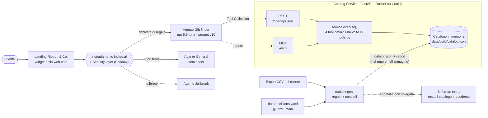
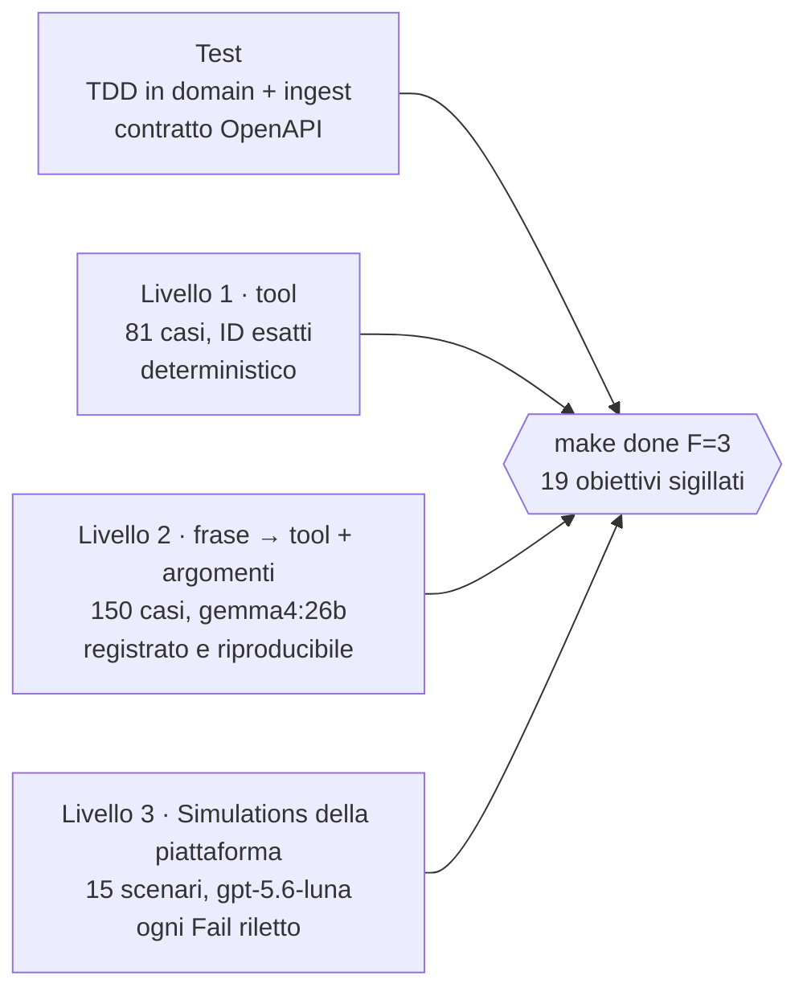

🇮🇹 Italiano · [🇪🇸 Español](README.es.md) · [🇬🇧 English](README.en.md)

# Gift Shop Catalog


Un servizio di catalogo e un agente che aiuta a trovare regali, per un piccolo negozio online.
È la prova tecnica di indigo.ai per il ruolo di AI Forward Deployed Engineer. Il **Catalog
Service** (Python, FastAPI) pulisce l'export CSV del cliente con un ingest ripetibile e
controllato, ed espone quattro tool di sola lettura: via REST, con un documento OpenAPI scritto
per un modello linguistico, e via MCP. L'**agente Gift finder**, sulla piattaforma indigo.ai,
trasforma una richiesta vaga o precisa in al massimo tre prodotti, ciascuno con un motivo, nella
lingua del cliente. Vive nella chat della landing di un negozio inventato, *Ribbon & Co.*

## Link

| Cosa | Dove |
|---|---|
| Landing con la chat | https://catalog.178.18.243.118.sslip.io/ |
| Pagina di test dell'agente | `<TEST_PAGE_URL>` |
| Documento OpenAPI (senza chiave) | https://catalog.178.18.243.118.sslip.io/openapi.json |
| Endpoint MCP (Streamable HTTP) | https://catalog.178.18.243.118.sslip.io/mcp |
| Health | https://catalog.178.18.243.118.sslip.io/health |
| Parte 1 · Come lavoro con l'IA | [PDF, una pagina](docs/ai-workflow/AI_WORKFLOW-it.pdf) · [Markdown (inglese)](AI_WORKFLOW.md) |
| Video | `<VIDEO_URL>` |

Tutti gli endpoint di dati e `/mcp` richiedono l'header `X-API-Key` (`/mcp` accetta anche
`Authorization: Bearer <key>`). Senza chiave rispondono 401, con un corpo che spiega come
inviarla. La landing, `/openapi.json` e `/health` sono pubblici.

Il dominio usa sslip.io, che include l'IP del server nel nome. Decisione: nessun dominio
acquistato per una demo, perché sslip.io offre gratis un certificato Let's Encrypt valido e l'IP
di un server non è un segreto. In produzione il servizio starebbe dietro il dominio del cliente.

## Il giro in cinque minuti

1. **Parla con l'agente** sulla [landing](https://catalog.178.18.243.118.sslip.io/): una richiesta vaga ("un regalo per mia mamma"),
   una precisa ("qualcosa per chi ama il caffè, sui 50 euro", poi "mostrami altro") e una fuori tema.
2. **Leggi quello che legge il modello**: [`/openapi.json`](https://catalog.178.18.243.118.sslip.io/openapi.json), senza chiave.
   Perché descrizioni e risposte sono così: [Tool pensati per un LLM](#tool-pensati-per-un-llm).
3. **Controlla i numeri**: [Misurato](#misurato), ogni cifra con il suo `n`, comando e artefatto.
4. **Guarda cosa richiedevano i dati del cliente**: [Dati: pulizia e sicurezza dei nuovi export](#dati-pulizia-e-sicurezza-dei-nuovi-export).
5. **Valuta i compromessi**: [Cosa è rimasto fuori](#cosa-è-rimasto-fuori-e-cosa-farei-dopo) e [Tempo impiegato](#tempo-impiegato).

## Tecnologie

| Ambito | Scelta |
|---|---|
| Linguaggio e runtime | Python 3.13 (fissato in `.python-version`), [uv](https://docs.astral.sh/uv/) per le dipendenze, versioni esatte (`==`) |
| Servizio | FastAPI e Pydantic, servito da Uvicorn |
| MCP | MCP Python SDK 2.3.0, trasporto Streamable HTTP, senza stato |
| Qualità | pytest + hypothesis (test di proprietà), ruff, mypy strict, tiktoken (`o200k_base`) per misurare le risposte in token, detect-secrets |
| Deploy | Docker (immagine non-root con il suo health check), Coolify su un VPS Contabo, Traefik con Let's Encrypt via sslip.io; un push su `main` rifà il deploy |
| Agente | Piattaforma indigo.ai: Gift finder su **gpt-5.6-luna**, agenti General e Jailbreak, Security layer, widget della web chat |
| Eval di livello 2 | Ollama con **gemma4:26b**, in locale, temperatura 0, ogni risposta registrata |

## Come funziona



- **Una sola definizione dei tool, due trasporti.** `tools.py` contiene una volta sola nome,
  descrizioni e parametri di ogni tool. Il documento OpenAPI e la lista di tool MCP si generano
  da lì, e ogni rotta REST e ogni `tools/call` MCP passa da `service.execute`. Decisione:
  generarli da un'unica fonte, perché due copie scritte a mano divergono, e il comportamento del
  modello dipende da ogni parola della descrizione. `make eval-mcp` verifica che MCP restituisca
  lo stesso risultato di REST su ogni caso di livello 1 (ADR-002, ADR-008).
- **L'ingest è l'unico codice che legge il CSV** (ADR-001, ADR-009). Tutto ciò che non sa
  spiegare lo ferma, e resta in servizio il catalogo precedente.
- **Snapshot in memoria** (ADR-004). All'avvio il servizio carica `catalog.json` (152 schede, 150
  prodotti) e risponde dalla memoria; il p95 della ricerca è 0,20 ms in processo. La ricerca è
  una scansione lineare: un catalogo sintetico ×100 ha dato 35–39 ms di p95 e 64 MB. Decisione:
  nessun database, perché a questa scala aggiunge un componente senza un guadagno misurabile. Il
  vero limite è la freschezza dello stock: è aggiornato quanto l'ultimo export. Ogni risposta
  porta `meta.catalog_version`, così ogni risposta si può ricondurre all'export da cui viene.

## Tool pensati per un LLM

La piattaforma trasforma ogni operazione OpenAPI in un tool, e il modello decide cosa chiamare
**solo da nomi e descrizioni**. Le descrizioni sono quindi l'interfaccia. Le risposte sono
scritte per un modello che non deve inventare nulla (ADR-002).

### Quattro tool, un compito ciascuno

| Tool | Rotta | Compito |
|---|---|---|
| `get_categories` | `GET /categories` | Cosa vende il negozio: categorie, sottocategorie, conteggi, fasce di prezzo, valori ammessi nei filtri |
| `get_products_by_category` | `GET /categories/{category}/products` | Sfogliare una categoria nominata dal cliente |
| `search_products` | `GET /products/search` | Trovare prodotti in tutto il catalogo partendo da una descrizione |
| `get_product_details` | `GET /products/{product_id}` | Tutto su un prodotto, avvertenze e alternative disponibili comprese |

La consegna chiede il primo, il secondo e il quarto. Decisione: aggiungere `search_products`,
perché uno stress test di 100 conversazioni (671 messaggi in inglese, spagnolo e italiano) ha
mostrato che quasi tutte le richieste nominano un tipo di prodotto, un hobby o una marca, non una
categoria. La ricerca non ha di proposito un parametro `category`: così il modello non deve mai
scegliere tra due tool che fanno la stessa cosa.

Filtri comuni: fascia di prezzo, `recipient` (uno o più, `her,couple`), `occasion`,
`max_shipping_days`, `exclude` (parole cercate in nome, sottocategoria, tag e materiale, mai
nella descrizione), `include_out_of_stock`, `sort`, `limit` (1–10, default 5) e `offset`.

<details>
<summary>Tool valutati e scartati</summary>

Con le ragioni in ADR-002: prodotti simili, dettagli in blocco, politiche del negozio (non ci
sono dati sulle politiche, e un tool inviterebbe il modello a riempire il vuoto),
`recommend_gift` (è il lavoro dell'agente, e nasconderebbe il ragionamento) e un tool di
"guardia" contro le injection (verrebbe eseguito solo se il modello manipolato decidesse di
chiamarlo).

</details>

### Cosa dice una risposta al modello

Ogni elemento della lista contiene tutto ciò che serve per consigliarlo, senza una seconda
chiamata: prezzo, disponibilità, valutazione e numero di recensioni, destinatario, occasioni,
giorni di spedizione, confezione regalo e la descrizione del negozio, dove stanno le avvertenze
("richiede un amplificatore"). I blocchi opzionali compaiono solo quando portano informazione:

| Blocco | Risponde a |
|---|---|
| `missing_terms` | Per ogni prodotto, le parole della richiesta che la sua scheda non menziona. Il quaderno semplice per "leather notebook" dice `["leather"]` |
| `over_budget_matches` | "Un coltello da chef sotto i 100 €": l'unico costa 149 €. Risultati migliori oltre il budget, con `over_by_eur` |
| `out_of_stock_matches` | "Avete il puzzle City Map?" Esiste ma è esaurito, quindi l'agente non dice mai che il negozio non lo vende |
| `in_stock_alternatives` (dettagli) | Cosa offrire al posto di un prodotto esaurito: prima la stessa sottocategoria, poi il prezzo più vicino |
| `unmatched_terms` | "Cuffie Sony": il negozio non tratta Sony, l'agente lo dice e propone la cosa più vicina |
| `suggestions` | Con pochi risultati: il cambio di filtro che ne aggiunge, ad esempio `max_price` → 149 ne aggiunge 3. Solo cambi che conservano il senso della richiesta: mai togliere un'esclusione o il destinatario (ADR-011) |
| `meta` | `total_matches`, `returned`, `next_offset` per "mostrami altro", filtri applicati, data di oggi, versione del catalogo |

Un risultato vuoto è un 200 con `total_matches: 0` e dei suggerimenti, non un errore. **Budget di
token:** ogni risposta di livello 1 viene misurata in token (`o200k_base`). La più grande è di
621 con la pagina di default e di 1.045 con 10 elementi, contro limiti sigillati di 1.150 e
1.800.

### Input tolleranti, errori recuperabili

Il server risolve quello che può e lo segnala in una `note`: una categoria per slug, per nome in
qualsiasi grafia o per una sola parola ("kitchen"); un ID prodotto come `kd-7`, `KD7` o `kd-007`;
valori di insiemi chiusi in maiuscolo o minuscolo (`HER`, `Birthday`); un `limit` oltre 10 viene
ridotto. Decisione: tollerarli, perché un modello che scrive un valore in maiuscolo non deve
pagarlo con un'altra chiamata. Ciò che non si può risolvere è un 4xx sempre con la stessa forma,
che dice al modello come correggere la chiamata:

```json
{"error": {"code": "unknown_category",
           "message": "'garden' is not a category; Garden is a subcategory of Home & Living.",
           "hint": "Call get_products_by_category with category 'home-living' and subcategory 'Garden'.",
           "allowed_values": ["beauty-wellness", "..."], "did_you_mean": ["home-living"]}}
```

Rigido dove la rigidità informa: `nan`, `inf` e `min_price > max_price` sono 400 con un
suggerimento. Prima un intervallo invertito restituiva un 200 vuoto, che un modello legge come
"il negozio non ha niente".

<details>
<summary>Ricerca: deterministica, nessun modello nel ciclo</summary>

Punteggio per parole chiave, e lo chiamiamo così (ADR-003, ADR-005, ADR-006, ADR-007, ADR-010,
ADR-011). I campi forti dicono cos'è un prodotto (nome, sottocategoria, tag, occasioni, marca);
quelli deboli lo descrivono (materiale, colore, descrizione). I risultati si ordinano per
copertura della richiesta nei campi forti, poi per copertura in qualsiasi campo, poi per rarità
delle parole, poi per valutazione.

- In una richiesta di più parole, l'ultima parola specifica nomina il prodotto ("leather
  *notebook*"), quindi un cinturino da orologio in pelle non compare. Se nessun prodotto ha
  quella parola in un campo forte, la ricerca si restringe ai prodotti che l'hanno in uno
  qualsiasi dei loro campi ("travel pillow").
- Un piccolo vocabolario rivisto in `decisions.yaml` traduce le parole del cliente in quelle del
  catalogo ("noise cancelling" → `anc`, "kindle" → e-reader, `cooking` ↔ `kitchen`). I prodotti
  per animali hanno il loro destinatario, così un gioco per cani non risponde a "giocattolo per
  bambini".
- Il ranking è stato congelato dopo tre revisioni umane dei casi di livello 1. Ciò che le parole
  non possono decidere (gli auricolari open-ear non hanno la cancellazione del rumore) resta
  all'agente, che per questo vede `missing_terms`.

</details>

## L'agente

### Configurazione sulla piattaforma

| Pezzo | Configurazione |
|---|---|
| **Gift finder** | L'unico agente con tool. Campi del prompt da [`agent/system-prompt.md`](agent/system-prompt.md) (v10). gpt-5.6-luna (EU), reasoning Low, creatività Low, memoria breve di 20 messaggi, tutte le chiamate ai tool in memoria, 600 token di risposta |
| **General** | L'agente di fallback della piattaforma, senza tool: chiacchiere, meteo, resi, pagamenti, tracciamento. Non inventa mai una politica, non nomina prodotti, riporta la conversazione al regalo |
| **Agente Jailbreak** | Riceve i tentativi di jailbreak instradati dal Security layer |
| **Security layer** | Attivo, in modalità **Shadow**: classifica e registra ogni messaggio, per ora non blocca nulla |
| **Tool** | Una Tool Collection da `/openapi.json`, con header `X-API-Key: [[CATALOG_API_KEY]]` da un secret del workspace. Anche il server MCP è stato collegato e provato da capo a fondo in Preview; l'agente gira su REST |

Decisione: prima Shadow, poi Enforce, perché Enforce su "fuori tema" può bloccare un messaggio
misto che contiene anche una vera richiesta di regalo, e i falsi positivi vanno letti prima. Il
guardrail Hallucination della piattaforma non è disponibile in questo workspace; copre quel
rischio la regola del prompt "ogni dato di prodotto viene da una chiamata a un tool", che il
livello 2 misura.

### Design della conversazione

Il prompt è scritto nei campi della piattaforma: descrizione, obiettivo, tono, dieci regole
generali e cinque sezioni (fare domande, formato delle raccomandazioni, uso del catalogo, lettura
dei risultati, fuori dal negozio). Le regole che danno forma alla conversazione:

- **Al massimo una domanda per messaggio, e al massimo due prima di mostrare prodotti.** Appena
  si conosce la persona, un budget o un tipo di prodotto, l'agente cerca e mostra, poi chiede. A
  un vago "mi serve un regalo" risponde con una sola domanda leggera: per chi è, e più o meno
  quanto vuoi spendere?
- **Fino a tre prodotti per messaggio**, il migliore per primo, in una lista numerata con una
  riga per prodotto: `1. **Nome** · €prezzo · di solito spedito in N giorni — un motivo legato a
  ciò che ha detto il cliente`. "Ne restano solo N" quando lo stock è basso, poi un breve passo
  successivo. Decisione: una lista, perché il widget univa i blocchi di due righe comunque si
  mettessero le righe vuote, e i numeri permettono al cliente di dire "il secondo".
- **Ogni dato di prodotto viene da una chiamata a un tool.** Se cambia una condizione, l'agente
  cerca di nuovo; prima di dire che il negozio ha o non ha qualcosa, lo cerca.
- **Risponde nella lingua dell'ultimo messaggio del cliente**; le query ai tool restano in
  inglese, con le parole del catalogo.
- **Non garantisce mai la consegna.** I giorni di spedizione sono una stima del negozio: "di
  solito spedito in 3 giorni".
- **Legge i blocchi:** "esaurito", mai "non lo vendiamo"; di quanto un prodotto gradito supera il
  budget (il budget è la cifra detta dal cliente); dice chiaramente quando il negozio non tratta
  una marca; "mostrami altro" pagina con `offset` e gli stessi filtri, e non alza mai il budget
  di sua iniziativa.
- **Non conferma mai una proprietà che la scheda non riporta.** A "è sicuramente vegano?"
  risponde "il catalogo non dice se è vegano", poi indica i materiali.

### Messaggi fuori tema e tentativi di manipolazione

A strati, e nessuno dipende dal fatto che il modello scelga di proteggersi:

1. **Prima del modello:** il Security layer classifica ogni messaggio; i tentativi di jailbreak
   vanno all'agente Jailbreak, le richieste fuori ambito a General.
2. **Nel prompt:** a meteo o codice risponde con una frase e una domanda che torna al regalo.
   Resi, pagamenti, sconti e tracciamento: "non ho informazioni su questo", un rimando al servizio
   clienti, nessuna supposizione. Ignora i cambi di ruolo e le richieste di rivelare le
   istruzioni. "Avete gli AirPods?" è una domanda sul negozio: si cerca, non si rifiuta.
3. **Nel servizio:** i tool leggono solo dati pubblici del catalogo, quindi un'injection riuscita
   può leggere solo ciò che è già pubblico. Un testo di prodotto che sembra un'istruzione ferma
   l'ingest (`instruction_like_text`); il confronto avviene su testo normalizzato, così i
   caratteri a larghezza zero non lo nascondono.

Il livello 2 misura il secondo strato: nessuno dei 36 casi fuori tema chiama un tool del
catalogo.

<details>
<summary>Scelta del modello, con un confronto controllato</summary>

gpt-4.1-mini allungava le risposte e leggeva male i risultati ("niente sotto gli 80" accanto a un
prodotto da 78 €), e nessuna regola del prompt lo ha corretto. Cinque modelli hanno poi eseguito
gli stessi nove scenari, con tutto il resto fisso: un benchmark pubblico (τ²-Bench Airline) ha
scelto quali provare, gli scenari hanno deciso. **gpt-5.6-luna** ha superato i sei scenari core
dopo la lettura di ogni Fail, ha segnalato i prodotti fuori budget con la differenza e ha
mantenuto la lingua del cliente, a metà del prezzo di gpt-4.1-mini. Due modelli meglio
classificati dal benchmark qui hanno fallito (lingua sbagliata; token grezzi di chiamate ai tool
nella chat). Tabella completa in [`docs/PLATFORM.md`](docs/PLATFORM.md).

</details>

## Dati: pulizia e sicurezza dei nuovi export

L'export del cliente (`data/gift-shop-catalog.csv`, 152 righe) non si modifica mai. `make ingest`
lo trasforma nel catalogo servito (ADR-001, ADR-009):

- **Le regole generali stanno nel codice, con i test:** spazi, maiuscole, `and` → `&`, vuoto
  significa mancante (mai zero).
- **I giudizi puntuali stanno in [`data/decisions.yaml`](data/decisions.yaml)**, ognuno con il
  suo motivo: 11 categorie, due prodotti in doppia categoria, stock 999 = buono regalo illimitato,
  il vocabolario di ricerca.
- **Tutto il resto ferma l'ingest** con un codice preciso e mantiene il catalogo precedente:
  categoria sconosciuta, ID duplicato, valore non valido, testo di prodotto che sembra
  un'istruzione, schema errato, file non UTF-8 o vuoto, riga con colonne in più o in meno, oltre
  il 20% dei prodotti rimossi, più della metà con prezzo o stock cambiati in un colpo solo. Un
  cambio massivo legittimo (i saldi) si accetta per un solo file, identificato dal suo sha256.
- **Ogni export è una fotografia completa**, confrontata con il catalogo attuale, e a parità di
  input l'output è identico byte per byte. `data/build/` è nel repo, quindi un nuovo export è un
  diff rivisto, un commit e un nuovo deploy.

Diciassette anomalie seminate (una colonna di prezzo duplicata, UTF-16, una riga sbilanciata, uno
spazio a larghezza zero dentro "Ignore previous instructions", un cambio di prezzi massivo…)
fermano ciascuna l'ingest con il proprio codice esatto: 17/17.

## Valutazione

Test ≠ eval. I test fissano il comportamento del codice e devono passare sempre (`make
gate-fast`). Le eval misurano la qualità rispetto a una soglia, ciascuna con il suo comando e il
suo artefatto in [`docs/GOALS.yaml`](docs/GOALS.yaml), sigillato da un lock sha256. `make done
F=3` legge ogni artefatto e lo confronta con la sua soglia.



<details>
<summary>Cosa fa ogni livello</summary>

- **Test.** TDD obbligatorio in `domain` e `ingest`; lo strato API è testato sul contratto, con
  uno snapshot della OpenAPI servita e un controllo che i parametri delle rotte coincidano con la
  specifica.
- **Livello 1, i tool (deterministico).** Argomenti → ID di prodotto esatti, blocchi ed errori,
  eseguiti via HTTP. I risultati attesi vengono da un'implementazione di riferimento indipendente
  (`evals/golden/l1/oracle.py`, solo libreria standard). Poi il titolare ha rivisto i casi come
  farebbe un commesso, in più round (`evals/golden/l1/review-v*.md`); i suoi commenti hanno
  portato agli ADR da 005 a 007 e all'ADR-011, e prima di ogni round di regole sono stati
  registrati casi di controllo esclusi dallo sviluppo.
- **Livello 2, frase → tool e argomenti, con un modello reale.** 150 casi (36 fuori tema),
  ciascuno con la conversazione fin lì e l'ultimo messaggio. Il modello legge solo la specifica
  servita e il prompt, tramite function calling. Gira in locale su Gemma 4 26B (la piattaforma
  offre gemma-4-26b), a temperatura 0, e ogni risposta viene registrata: i numeri si ricalcolano
  offline, senza modello e senza chiave.
- **Livello 3, conversazioni: le Simulations della piattaforma.** 15 scenari in
  [`evals/simulations/scenarios.csv`](evals/simulations/scenarios.csv): i sei della consegna
  (`core`), altri tre (`extra`) e sei costruiti sull'output reale dei tool (`extended`). Il
  giudice vede la conversazione ma non il catalogo, quindi i criteri giudicano il comportamento e
  considerano sbagliato un dato solo se contraddice il riferimento. Ogni Fail viene riletto contro
  il catalogo prima di registrare il risultato, e la tabella riporta entrambi i verdetti.

</details>

### Misurato

L'ultima esecuzione di ogni comando. I report sono in [`evals/reports/`](evals/reports/).

| Metrica | Valore | Soglia | n | Comando | Artefatto |
|---|---|---|---|---|---|
| Test unitari e di contratto | 529 superati | tutti | 529 | `make test` | — |
| Copertura di righe, domain + ingest | 99,77% | ≥ 85% | 872 istruzioni | `make test` | `coverage-latest.json` |
| Violazioni di strato (domain ↛ api/mcp, api ↮ mcp) | 0 | 0 | — | `make test` | `arch-latest.json` |
| Endpoint di dati che rifiutano una chiave assente, errata o vuota | 12/12 | tutti | 12 | `make test` | `auth-latest.json` |
| Livello 1: ID di prodotto esatti (URL pubblico) | 81/81 | tutti | 81 | `make eval-l1` | `l1-latest.json` |
| Livello 1: risposta più grande, pagina di default / massima | 621 / 1.045 token | ≤ 1.150 / 1.800 | 81 | `make eval-l1` | `l1-latest.json` |
| Livello 1: casi rivisti dal titolare | 69 approvati, 6 rinviati, 6 in attesa (cambiati dall'ADR-011) | — | 81 | foglio di revisione | `evals/golden/l1/REVIEW.md` |
| Livello 2: tool giusto (gemma4:26b, prompt v10) | 85,3% | ≥ 90% (**non raggiunto**, vedi sotto) | 150 | `make eval-l2` | `l2-latest.json` |
| Livello 2: argomenti giusti, dato il tool giusto | 96,2% | ≥ 85% | 150 | `make eval-l2` | `l2-latest.json` |
| Livello 2: casi fuori tema che chiamano un tool | 0% | ≤ 5% | 36 | `make eval-l2` | `l2-latest.json` |
| Livello 2: differenze nel replay | 0 | 0 | 150 | `make eval-l2` | `l2-latest.json` |
| Simulations, core (gpt-5.6-luna, prompt v10) | 6/6 | 100% | 6 (1 run) | `make sim-report` | `simulations-latest.json` |
| Simulations, extended / extra (prompt v10) | 6/6 · 2/3 | — | 6 · 3 (1 run) | `make sim-report` | `simulations-latest.json` |
| Simulations, prompt v8: core / extra / extended, dopo la lettura | 18/18 · 9/9 · 16/18 | — | 3 run | registrato per run | `evals/simulations/results.csv` |
| Ingest: export del cliente, decisioni in sospeso | 0 | 0 | 152 righe | `make ingest` | `data/build/ingest-report.json` |
| Ingest: anomalie seminate fermate con il codice esatto | 17/17 | tutte | 17 | `make eval-ingest` | `ingest-latest.json` |
| MCP: stesso risultato di REST (in processo e URL pubblico) | 81/81 | tutti | 81 | `make eval-mcp` | `mcp-latest.json` |
| MCP: controlli di protocollo su Streamable HTTP | 16/16 | tutti | 16 | `make eval-mcp` | `mcp-latest.json` |
| Violazioni delle regole OpenAPI | 0 | 0 | — | `make spec-lint` | `spec-lint-latest.json` |
| Nuovi segreti fuori dalla baseline rivista | 0 | 0 | — | `make secrets` | `secrets-latest.json` |
| Latenza p95 in produzione, lista e ricerca | 193,4 ms su una connessione riutilizzata (357,9–384,9 ms aprendo una nuova connessione TLS a ogni chiamata) | ≤ 300 ms | 3 run × 200 chiamate, 20 di riscaldamento | `make latency URL=…` | `latency-latest.json` |
| Controlli pubblici dall'esterno | 7/7 | tutti | 7 | `make check-public URL=…` | `public-latest.json` |
| Definizione di fatto, fase 3 | 18/19 (fallisce solo G-L2-TOOL) | 19/19 | 19 obiettivi | `make done F=3` | — |

**G-L2-TOOL non è raggiunto, e la soglia non è stata abbassata.** Scelta del tool sul modello
locale, per versione del prompt: v3 87,3%, v4 81,3%, v5 88,0%, v6 88,7%, v7 87,3%, v8 90,0%, v9
88,7%, v10 85,3%, contro ≥ 90%. Nessuna di queste modifiche riguardava la scelta del tool,
eppure il numero si è mosso fino a 6,7 punti (da v4 a v5 è cambiato solo il layout): va letto
come "circa 85–90% su questo modello locale". Quasi tutti gli errori sono il modello che risponde
dai messaggi precedenti invece di chiamare un tool. Decisione: tenere il 90%, perché abbassarlo a
posteriori sposterebbe la porta, e rifinire il prompt per un modello che non è in produzione
ottimizzerebbe la cosa sbagliata. Il modello di produzione supera gli scenari core.

<details>
<summary>Come si contano le Simulations, e cosa hanno trovato</summary>

Ogni run è registrato in `evals/simulations/results.csv` con entrambi i verdetti (quello del
giudice e quello dopo la lettura). I run dello stesso modello e della stessa versione
dell'agente si contano insieme, così ripetere un run non può far diventare verde un risultato. I
fallimenti reali, e cosa ha portato ciascuno:

- **v4**, "le piace cucinare" trovava solo il libro di cucina, e "tech gadgets" non trovava la
  cassa e la fotocamera: un buco di vocabolario, corretto nei dati (ADR-010).
- **v7**, "budget sui 40": una candela da 42 € definita "entro il budget". v8: il budget è la
  cifra detta dal cliente, e tutto ciò che la supera si segnala come fuori budget, con
  l'importo.
- **v8**, "è sicuramente vegano?" con risposta "Sì" in base ai materiali, e un gioco da festa
  definito "chiaramente adatto ai bambini". v9 e v10: mai confermare ciò che la scheda non dice.
- **v10**, extra-9: un prodotto da 52 € segnalato come esaurito senza dire che supera anche di 2 €
  un budget "sui 50". Reale ma minore; qui si è smesso di iterare sul prompt, perché ogni riga in
  più corregge una formulazione e ne rischia un'altra.

La latenza si misura su una connessione riutilizzata, come fa un client server-to-server quale la
piattaforma; dalla macchina del cliente, un nuovo handshake TCP e TLS a ogni chiamata aggiunge
circa 115 ms.

</details>

## Cosa ci ha insegnato la piattaforma

Visto a schermo, corretto e documentato in [`docs/PLATFORM.md`](docs/PLATFORM.md):

- **La piattaforma importa il `summary` di un'operazione, non la sua `description`.** Il primo
  import dava al modello riassunti di una riga. Ora la specifica servita mette il testo completo
  in entrambi i campi, e un nuovo import non richiede modifiche a mano.
- **Un enum può impedire al modello di cercare.** Alla richiesta "la categoria giardino", il
  modello sceglieva il valore dell'enum più vicino (`outdoor-travel`). Ora il tool di navigazione
  gli dice di cercare quando la parola del cliente non è una categoria.
- **I corpi dei 4xx arrivano al modello.** Chiedendo "lampade", l'agente riceveva il 404 e
  richiamava con `Lighting`, la sottocategoria indicata dall'errore.
- **Il client MCP inviava il segnaposto del secret, non il suo valore.** Un log per richiesta su
  `/mcp` (mai la chiave) mostrava una chiave di 19 caratteri: la lunghezza di
  `[[CATALOG_API_KEY]]`. Nel sandbox si è aggirato scrivendo la chiave nell'header MCP; `/mcp`
  accetta anche `Authorization: Bearer`.
- **Il widget rifiuta l'URL di un'icona SVG** (si carica un PNG) e mostra la `&` del nome
  dell'assistente come `Ribbon &amp; Co.`, per cui si chiama "Ribbon and Co.".
- **Il Markdown del widget univa i blocchi prodotto di due righe**: da qui una riga numerata per
  prodotto.
- La specifica servita è OpenAPI 3.0.3, con ogni schema ed enum inline (niente `$ref`, niente
  `oneOf`), così l'editor a form della piattaforma può ancora modificare ogni operazione. `make
  spec-lint` lo garantisce.

## Eseguirlo in locale

Requisiti: [uv](https://docs.astral.sh/uv/) (Python 3.13 è fissato in `.python-version`). Per
rigenerare il livello 2 serve anche Ollama con `gemma4:26b`; per rieseguire le registrazioni no.

```bash
uv sync
cp .env.example .env          # imposta CATALOG_API_KEY
make run                      # http://localhost:8000
curl -H "X-API-Key: $CATALOG_API_KEY" "localhost:8000/products/search?query=candle&max_price=40"
make gate-fast                # lint, tipi e tutti i test
```

**Docker:** `docker build -t gift-shop-catalog . && docker run -p 8000:8000 -e
CATALOG_API_KEY=change-me gift-shop-catalog`. L'immagine include il catalogo del repo (nessun
passo di ingest), gira con un utente non-root e dichiara il suo health check.

<details>
<summary>Variabili d'ambiente</summary>

| Variabile | Obbligatoria | Significato |
|---|---|---|
| `CATALOG_API_KEY` | sì | La chiave che i client inviano in `X-API-Key`. Senza, il servizio non parte |
| `WIDGET_TOKEN` | no | Il token del workspace della piattaforma per la web chat su `/`. Senza un token valido, la pagina si apre senza chat |
| `SHOP_TIMEZONE` | no | Il fuso orario di `meta.today`. Default `Europe/Rome` |
| `CATALOG_URL` | no | Esegue `make eval-l1` contro un deploy invece che in processo |
| `TEST_PAGE_URL` | no | La pagina di test dell'agente, verificata da `make check-public` |

</details>

<details>
<summary>Target del Makefile</summary>

| Target | Cosa fa |
|---|---|
| `make gate-fast` | Lint, tipi e tutti i test: ciò che deve restare verde dopo ogni modifica |
| `make test` | pytest con i report di copertura, autenticazione e strati (`make lint` e `make typecheck` fanno il resto) |
| `make ingest` | CSV + `decisions.yaml` → `data/build/catalog.json` e il report; exit 1 significa che serve una decisione |
| `make eval-ingest` | Ogni fixture con un'anomalia seminata deve fermare l'ingest con esattamente quell'anomalia |
| `make eval-l1` | Casi di livello 1 via HTTP: corrispondenza esatta e dimensione della risposta in token |
| `make golden-l1` | Ricostruisce i casi di livello 1 dall'implementazione di riferimento, più il foglio di revisione |
| `make eval-l2` | Livello 2 rieseguito dalle risposte registrate del modello |
| `make eval-l2-refresh` | Livello 2 chiamando il modello locale per i casi senza registrazione |
| `make eval-mcp` | MCP contro REST sui casi di livello 1, più i controlli di protocollo; `URL=` per un deploy |
| `make sim-report` | Verdetti delle Simulations registrati per run → report |
| `make spec-lint` | Controlla la OpenAPI servita rispetto alle regole della piattaforma |
| `make secrets` | Segreti nei file tracciati che non sono nella baseline rivista |
| `make latency URL=…` · `make check-public URL=…` | Latenza p95 e controlli pubblici contro un deploy |
| `make done F=<n>` | Definizione di fatto di una fase: l'artefatto di ogni obiettivo contro la sua soglia sigillata |
| `make audit-csv` | Audit indipendente dell'export grezzo, solo libreria standard |

</details>

<details>
<summary>Struttura del repository</summary>

| Percorso | Contenuto |
|---|---|
| `src/catalog/tools.py` | I quattro tool, definiti una volta: nome, descrizione per il modello, parametri, schema della risposta |
| `src/catalog/service.py` | `execute()`: un unico punto d'ingresso per ogni chiamata, condiviso da REST e MCP; normalizzazione degli input; corpi delle risposte |
| `src/catalog/domain/` | Il catalogo in memoria: ricerca, navigazione, dettagli, ranking, quasi-risultati. Nessun import del framework web |
| `src/catalog/ingest/` | CSV + decisioni → catalogo servito e report, con ogni regola di arresto |
| `src/catalog/api/` | App FastAPI (`app.py`), OpenAPI generata (`openapi.py`), server MCP (`mcp.py`), landing |
| `data/gift-shop-catalog.csv` | L'export del cliente, così come è arrivato. Mai modificato |
| `data/decisions.yaml` | Giudizi umani, ognuno con il suo motivo: categorie, doppie categorie, valori sentinella, controlli, vocabolario di ricerca |
| `data/build/` | `catalog.json` (ciò che il servizio serve) e `ingest-report.json`. Nel repo, così un nuovo export è un diff |
| `agent/system-prompt.md` | Il prompt dell'agente, campo per campo come lo prende la piattaforma, con lo storico delle versioni |
| `evals/` | Casi di livello 1, casi e registrazioni di livello 2, scenari e risultati delle Simulations, eval di ingest e MCP, report |
| `docs/` | ADR, obiettivi e relativo lock, configurazione della piattaforma, diario di ingegneria, PDF della Parte 1 |
| `scripts/` | Lint della specifica, controllo dei segreti, riepilogo della copertura, controlli remoti, definizione di fatto, prova di scala, audit del CSV grezzo |

</details>

## Tempo impiegato

Circa **33 ore in cinque giorni**, dal diario di ingegneria, che registra ogni blocco di lavoro
con la sua durata approssimativa (da finalizzare alla consegna).

| Giorno | Lavoro principale | Tempo |
|---|---|---|
| Gio 29 ott | Consegna, guida della piattaforma, obiettivi, scelta dell'hosting, audit dei dati, design della pipeline | ≈ 7 h |
| Ven 30 ott | Ingest e dominio con TDD, stress test di 100 conversazioni, interfaccia dei tool, REST e OpenAPI, tre revisioni dei casi di livello 1 | ≈ 7 h 20 |
| Sab 31 ott | Deploy, livello 2 su un modello locale, prompt v2–v3, configurazione della piattaforma, prime Simulations | ≈ 6 h 15 |
| Dom 1 – lun 2 nov, fino a notte | Prompt v4–v10, confronto tra modelli, sicurezza dei nuovi export, MCP, landing, vocabolario di ricerca, latenza, MCP sulla piattaforma, Simulations, revisione del banco v5, README, Parte 1 | ≈ 12 h 25 |

Per area, a grandi linee: l'agente (prompt, livello 2, piattaforma, scelta del modello,
Simulations) ≈ 11,5 h; interfaccia dei tool e ricerca, revisioni comprese ≈ 8 h; comprensione
della consegna e della piattaforma, obiettivi, regole di lavoro ≈ 4 h; dati ≈ 3,5 h; hosting e
latenza ≈ 2 h; MCP e landing ≈ 1,5 h; README e Parte 1 ≈ 1 h.

## Cosa è rimasto fuori, e cosa farei dopo

Lasciato fuori di proposito, ognuno con la sua ragione nell'ADR indicato:

- **Una pagina `/catalog/report`** con anomalie, decisioni e versione del catalogo. Tagliata per
  tempo; la stessa informazione è in `data/build/ingest-report.json`. Un portale per caricare i
  dati è stato scartato del tutto: un percorso di scrittura e un secondo schema di autenticazione
  su un sandbox pubblico (ADR-001).
- **Arricchimento dei dati di prodotto con un LLM** (ADR-003). Da riconsiderare quando il catalogo
  arriverà a migliaia di prodotti, o quando il livello 1 mostrerà errori dovuti a parole che
  nessuna colonna contiene, con una verifica di grounding nel codice e una revisione umana delle
  righe cambiate.
- **Un vero motore di ricerca** (ADR-004): SQLite FTS5 a decine di migliaia di prodotti, poi un
  servizio di ricerca con ingest incrementale, stock in tempo reale e paginazione a cursore.
- **Lacune dell'ingest** (ADR-009): il controllo sulle rimozioni non ha un'accettazione per
  singolo export, solo la sua soglia; i nomi delle colonne non vengono normalizzati (`PRICE_EUR`
  ferma l'ingest, di proposito); lettere simili di altri alfabeti (la `а` cirillica) possono
  ancora nascondere una frase di injection.
- **Mutation testing.** Tolto dagli obiettivi: una dipendenza in più, e non blocca nulla.

Prossimi passi, in ordine:

1. **Modalità Enforce per il Security layer**, dopo aver letto i log di Shadow in cerca di falsi
   positivi sui messaggi misti.
2. **Più run delle Simulations sul prompt v10.** Un solo run per suite può essere fortuna; un
   tasso di successo richiede più run per scenario.
3. **Segnalare alla piattaforma il segnaposto del secret in MCP**, e tornare a un secret del
   workspace invece della chiave scritta nell'header.
4. **Commenti sul ranking rinviati dal congelamento** (ADR-006): una coperta da sauna come plaid,
   incenso per bambini (un problema dei dati del cliente), un macinapepe per "coffee grinder", gli
   scacchi come gioco da tavolo in legno. Diventano regole solo se l'agente consiglia il prodotto
   sbagliato a causa dell'ordine.
5. **Ordine di `over_budget_matches`:** per "coffee" mette il macinino da 115 € sopra il set
   pour-over da 78 €, perché una corrispondenza nel nome batte una nei tag. Il prezzo più vicino è
   l'offerta migliore.
6. **Revisioni ancora aperte:** i 6 casi di livello 1 cambiati dall'ADR-011, e i casi di livello 2
   che il modello ha superato (una persona ha rivisto solo i fallimenti).

## Per approfondire

- [`docs/adr/`](docs/adr/): pulizia dei dati (001), interfaccia dei tool (002), niente
  arricchimento con LLM (003), catalogo in memoria (004), rilevanza della ricerca (005–007), server
  MCP (008), sicurezza dei nuovi export (009), vocabolario di ricerca e animali (010),
  suggerimenti e parola principale (011).
- [Diario di ingegneria](docs/JOURNAL.md): il ragionamento dietro ogni decisione, compreso ciò
  che non ha funzionato, con i numeri e i loro comandi.
- [Configurazione della piattaforma](docs/PLATFORM.md), [obiettivi](docs/GOALS.yaml),
  [prompt dell'agente](agent/system-prompt.md), [Parte 1 · Come lavoro con l'IA](AI_WORKFLOW.md).

I documenti in `docs/` e il codice sono in inglese.
